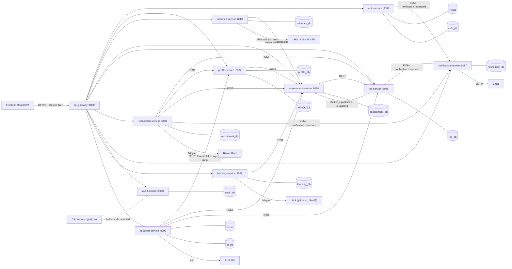

# Rikkei Jobs

> Nền tảng kết nối ứng viên thuộc hệ sinh thái Rikkei Education với doanh nghiệp tuyển dụng, dựa trên **năng lực đã được xác thực**.


-007396?logo=openjdk)


## Mục lục

- [1. Giới thiệu](#1-giới-thiệu)
- [2. Tính năng chính](#2-tính-năng-chính)
- [3. Phạm vi MVP](#3-phạm-vi-mvp)
- [4. Kiến trúc](#4-kiến-trúc)
- [5. Tech stack](#5-tech-stack)
- [6. Cấu trúc repository](#6-cấu-trúc-repository)
- [7. Bắt đầu nhanh](#7-bắt-đầu-nhanh)
- [8. Quy ước phát triển](#8-quy-ước-phát-triển)
- [9. Kiểm thử](#9-kiểm-thử)
- [10. Bảo mật và quyền riêng tư](#10-bảo-mật-và-quyền-riêng-tư)
- [11. Lộ trình](#11-lộ-trình)
- [12. Rủi ro và câu hỏi còn mở](#12-rủi-ro-và-câu-hỏi-còn-mở)
- [13. Tài liệu](#13-tài-liệu)
- [14. Đóng góp](#14-đóng-góp)
- [15. Đội ngũ](#15-đội-ngũ)
- [16. Giấy phép](#16-giấy-phép)

---

## 1. Giới thiệu

**Rikkei Jobs** đồng bộ trực tiếp điểm môn học, kết quả thi, kết quả thực tập (IOC) và đánh giá của Mentor từ các hệ thống đào tạo đang vận hành để dựng hồ sơ năng lực có bằng chứng xác thực. Ngoài việc ứng tuyển, hệ thống còn chỉ ra các kỹ năng ứng viên đang thiếu so với vị trí mong muốn và gợi ý lộ trình học bổ sung ngay trên LMS.

Hành trình của học viên/ứng viên:

```
Khảo thí → Rikkei LMS → Giám sát học tập → Thực tập IOC → Việc làm (Rikkei Jobs)
```

### Vai trò người dùng

| Vai trò | Cách đăng nhập |
|---|---|
| Ứng viên, Mentor, Cán bộ tuyển dụng, Quản trị | SSO từ `lms-student`, `lms-admin`, `lms-pm` bằng vé dùng một lần (hiệu lực tối đa 60 giây) |
| Doanh nghiệp (HR) | Tài khoản riêng do cán bộ hệ thống cấp. Bắt buộc đổi mật khẩu lần đầu, khóa 15 phút sau 5 lần nhập sai, link quên mật khẩu dùng một lần và hết hạn sau 30 phút |

## 2. Tính năng chính

Hệ thống gồm 7 module nghiệp vụ:

| # | Module | Nội dung |
|---|---|---|
| 1 | Hồ sơ năng lực ứng viên | Skill Profile có bằng chứng xác thực, CV chuẩn, Portfolio |
| 2 | Doanh nghiệp và JD | Hồ sơ doanh nghiệp, tài khoản HR, đăng và quản lý JD kèm kỹ năng và mức yêu cầu |
| 3 | Thực tập (IOC) | Đặt nhu cầu thực tập, ghép ứng viên vào đợt IOC, đồng bộ kết quả nghiệm thu về hồ sơ |
| 4 | Đánh giá năng lực | Phiếu Mentor, tự đánh giá, chỉ số năng lực tổng hợp, huy hiệu (Badge) |
| 5 | Đào tạo bổ sung | Phân tích Skill Gap, đề xuất môn học và bài học tương ứng trên LMS |
| 6 | Ứng tuyển và tuyển dụng | Ứng tuyển bằng CV → Sàng lọc → Phỏng vấn → Offer → Nhận việc |
| 7 | AI Career Assistant | Gợi ý việc làm, góp ý CV, luyện phỏng vấn giả định theo từng JD |

### Ba luồng nghiệp vụ

1. **Tuyển dụng**: HR đăng JD, cán bộ duyệt, hệ thống tính Điểm khớp (Matching Score 0–100), ứng viên ứng tuyển hoặc được mời, sau đó đi qua sàng lọc, phỏng vấn nhiều vòng, offer và nhận việc.
2. **Thực tập IOC**: doanh nghiệp tạo JD loại "Thực tập", cán bộ ghép ứng viên vào đợt IOC trên `lms-pm`, kết quả nghiệm thu và đánh giá của Mentor được đẩy về hồ sơ, doanh nghiệp gửi offer cho thực tập sinh đạt yêu cầu.
3. **Phát triển năng lực**: dựng Skill Profile từ dữ liệu LMS, Khảo thí, IOC, Mentor, so với JD mục tiêu để tìm Skill Gap, gợi ý môn học bổ sung, tự cập nhật chỉ số khi học xong và gợi ý ứng tuyển khi đạt chuẩn.

### Quy tắc tính điểm

- Chỉ số kỹ năng (0–100, bậc Cơ bản / Khá / Vững / Nâng cao) là trung bình cộng có trọng số của các nguồn bằng chứng **đã xác thực**. Trọng số do Quản trị viên cấu hình.
- Dữ liệu **tự khai** không được cộng vào chỉ số chính thức, chỉ hiển thị riêng để đối chiếu và luôn gắn nhãn "Tự khai".
- Thiếu kỹ năng bắt buộc của JD thì ứng viên vẫn được hiển thị kèm cảnh báo, không bị ẩn.
- Huy hiệu cấp theo điều kiện kép (ví dụ: bậc Vững trở lên và có ít nhất 1 bằng chứng từ Thực tập IOC). Quản trị viên có thể cấp hoặc thu hồi thủ công, bắt buộc kèm lý do.

## 3. Phạm vi MVP

Đặc tả đầy đủ gồm 7 module và 8 tích hợp. Với **6 thành viên và 10 tuần**, MVP giữ đủ luồng nghiệp vụ cốt lõi và mọi ràng buộc bảo mật bắt buộc, nhưng đơn giản hóa một số phần:

| Hạng mục | Cách xử lý trong MVP |
|---|---|
| API thật của LMS, Khảo thí, PM | Giả lập bằng **WireMock** theo hợp đồng API đã thống nhất |
| Rikkei Meet | Adapter với implementation giả, sinh link phòng họp dạng mock |
| Gửi email | Dev dùng **Mailpit**, staging dùng SMTP của nhà cung cấp |
| Elasticsearch / OpenSearch | Không dùng, tìm kiếm bằng PostgreSQL (`tsvector`, GIN) |
| Kubernetes | Staging chạy Docker Compose trên một máy chủ |
| Load test | Không thực hiện |

## 4. Kiến trúc

Microservice: 1 API Gateway, 9 service nghiệp vụ (chia theo miền nghiệp vụ), 1 service AI (Python) và 1 frontend SPA.



Frontend gọi mọi API qua gateway. Gateway kiểm tra chữ ký JWT và giới hạn tần suất. Các service tự kiểm tra quyền theo vai trò và quyền sở hữu dữ liệu. **Frontend không được coi là lớp bảo vệ.**

### Danh sách service

| Service | Port | Database | Trách nhiệm | Module nội bộ (package) |
|---|---|---|---|---|
| `api-gateway` | 8080 | Redis (rate limit) | Định tuyến, kiểm tra JWT, giới hạn tần suất, CORS | Không có |
| `auth-service` | 8081 | `auth_db` | Đổi vé SSO, đăng nhập HR, khóa tài khoản, đặt lại mật khẩu, cấp JWT, JWKS | `sso`, `hr-account`, `password`, `token` |
| `profile-service` | 8082 | `profile_db` | Hồ sơ ứng viên, CV, portfolio, chứng chỉ, upload tệp an toàn (MinIO/S3, ClamAV, Tika), consent, tìm kiếm ứng viên công khai, mở khóa liên hệ, xóa dữ liệu theo yêu cầu | `profile`, `file`, `consent`, `search`, `contact` |
| `evidence-service` | 8083 | `evidence_db` | Đồng bộ bằng chứng từ LMS, Khảo thí, PM. Ghi nhận chỉnh sửa tay và báo sai | `sync`, `source`, `evidence`, `override` |
| `assessment-service` | 8084 | `assessment_db` | Danh mục kỹ năng, phiếu tự đánh giá và phiếu Mentor, tính chỉ số, badge, điểm khớp, khoảng thiếu hụt (Skill Gap) | `catalog`, `form`, `scoring`, `badge`, `matching`, `gap` |
| `job-service` | 8085 | `job_db` | Hồ sơ doanh nghiệp, tạo và sửa JD (gồm JD loại "Thực tập"), kỹ năng bắt buộc và ưu tiên, duyệt JD, trạng thái JD | `company`, `job`, `approval` |
| `recruitment-service` | 8086 | `recruitment_db` | Ứng tuyển, state machine đơn ứng tuyển, phỏng vấn nhiều vòng, offer, hết hạn offer, nhắc lịch, adapter Rikkei Meet; thực tập IOC (nhu cầu, đợt, ghép ứng viên, nghiệm thu) | `application`, `interview`, `offer`, `scheduler`, `meet`, `ioc` |
| `notification-service` | 8087 | `notification_db` | Nhận sự kiện yêu cầu thông báo, gửi email theo template, thông báo trong ứng dụng | `consumer`, `email`, `inapp` |
| `audit-service` | 8088 | `audit_db` | Nhận và lưu nhật ký thao tác bất biến (append-only), truy vấn audit log cho cán bộ và Quản trị | `consumer`, `store`, `query` |
| `learning-service` | 8089 | `learning_db` | Ánh xạ kỹ năng thiếu sang môn học và bài học trên LMS, gợi ý lộ trình, ghi danh, theo dõi tiến độ học bổ sung | `mapping`, `roadmap`, `enrollment`, `progress` |
| `ai-career-service` | 8090 | `ai_db` (log), Redis (rate limit) | Trợ lý nghề nghiệp: gợi ý việc, review CV, mock interview | `chat`, `masking`, `quota`, `prompts` |

### Quy tắc giao tiếp giữa các service

- **REST đồng bộ** (kèm Resilience4j) cho các lời gọi cần kết quả ngay: `recruitment-service` gọi `job-service`, `profile-service` và `assessment-service`; `assessment-service` gọi `job-service` để lấy yêu cầu kỹ năng của JD; `profile-service` gọi `assessment-service` để lấy điểm khớp; `learning-service` gọi `assessment-service` để lấy Skill Gap.
- **Kafka bất đồng bộ** (qua Transactional Outbox) cho 5 topic: `evidence.changed`, `jd.published`, `jd.updated`, `notification.requested` và `audit.recorded`.
- **Thông báo**: các service cần gửi email hoặc thông báo (auth, job, recruitment) chỉ phát `notification.requested`, `notification-service` lo việc gửi.
- **Audit**: các service nghiệp vụ phát `audit.recorded` cho mọi thao tác nhạy cảm (chỉnh sửa bằng chứng, đổi chỉ số, mở khóa liên hệ, chuyển trạng thái ứng tuyển). `audit-service` chỉ INSERT, không UPDATE hoặc DELETE.
- **Sở hữu dữ liệu**: `profile-service` giữ consent và tìm kiếm cùng một database nên thu hồi công khai có hiệu lực ngay (D09, D10). Khi đơn ứng tuyển được nộp, `recruitment-service` gọi endpoint nội bộ của `profile-service` để mở khóa email và SĐT cho doanh nghiệp tương ứng.
- **Ngoại lệ xem hồ sơ sau khi rút công khai**: HR xem hồ sơ gắn với đơn ứng tuyển thông qua `recruitment-service`. Service này kiểm tra đơn thuộc JD của HR đó rồi mới lấy dữ liệu từ endpoint nội bộ của `profile-service`.
- Các endpoint nội bộ vẫn yêu cầu token hợp lệ và kiểm tra quyền như endpoint công khai, không tin tưởng ngầm giữa các service.
- Module `common` (do Tech Lead duy trì) chứa cấu hình bảo mật, lỗi chuẩn, audit client và tiện ích dùng chung. Hợp đồng REST (OpenAPI) và schema sự kiện Kafka phải được thống nhất từ tuần 1.

### Quyết định kiến trúc chính

| Mã | Quyết định |
|---|---|
| D01 | Microservice (1 gateway, 9 service nghiệp vụ nhỏ theo miền, 1 service AI, 1 SPA) |
| D02 | Java source 17, chạy trên JDK 25 LTS, Spring Boot 4.1.1 (cần kiểm tra tương thích ở tuần 1) |
| D03 | Mỗi service có database/schema PostgreSQL riêng, không truy cập DB của service khác |
| D04 | REST (kèm Resilience4j) cho đồng bộ; Kafka cho bất đồng bộ, chỉ 5 topic: `evidence.changed`, `jd.published`, `jd.updated`, `notification.requested`, `audit.recorded` |
| D05 | Transactional Outbox cho mọi sự kiện gửi qua Kafka |
| D06 | `audit-service` riêng nhận sự kiện `audit.recorded` từ các service, ghi bảng append-only (thu hồi UPDATE/DELETE, có trigger chặn) |
| D07 | JWT RS256, `auth-service` phát token, các service xác thực qua JWKS |
| D08 | Vé SSO lưu Redis, TTL 60 giây, tiêu thụ bằng `GETDEL` |
| D09 | Tìm kiếm ứng viên bằng PostgreSQL (`tsvector`, GIN) |
| D10 | Điều kiện công khai kiểm tra tại thời điểm truy vấn để thu hồi có hiệu lực tức thì |
| D11 | Access token giữ trong bộ nhớ, refresh token trong cookie HttpOnly, Secure, SameSite |
| D12 | AI service bằng FastAPI, che PII trước khi gọi LLM, contract không có email, SĐT, mã học viên |
| D13 | MinIO/S3 với presigned URL, quét ClamAV, kiểm tra MIME thật bằng Apache Tika |
| D14 | Monorepo, Maven multi-module, CI/CD bằng GitHub Actions |
| D15 | Mọi tích hợp ngoài đi qua lớp adapter, MVP dùng implementation giả lập |

Thay đổi công nghệ sau khi chốt phải được ghi vào `docs/adr/` kèm lý do.

## 5. Tech stack

| Lớp | Công nghệ |
|---|---|
| **Backend** | Java (source 17, JDK 25 LTS), Spring Boot 4.1.1, Spring Web MVC, Spring Security (OAuth2 Resource Server, JWT), Spring Data JPA, Flyway, MapStruct, Spring Batch, Quartz, Resilience4j, Spring Cloud Gateway, springdoc-openapi |
| **Dữ liệu và messaging** | PostgreSQL 17, Redis 7, Apache Kafka (KRaft), MinIO (dev) / S3 (staging) |
| **Bảo mật** | JWT RS256 + JWKS, Argon2id, ClamAV, Apache Tika, presigned URL |
| **Frontend** | React 19, TypeScript 5, Vite, Tailwind CSS v4, shadcn/ui, React Router v7, TanStack Query v5, React Hook Form + Zod, Axios, Recharts, openapi-typescript |
| **AI service** | Python 3.12, uv, FastAPI, Uvicorn, Pydantic v2, httpx, SQLAlchemy 2 + Alembic, SDK của nhà cung cấp LLM (Anthropic hoặc OpenAI) |
| **Hạ tầng và DevOps** | Docker, Docker Compose, GitHub Actions, Prometheus, Grafana, Mailpit, WireMock |
| **Kiểm thử** | JUnit 5, Mockito, AssertJ, Testcontainers, Vitest, Testing Library, Playwright, pytest, Bruno |

Không dùng Lombok. DTO dùng `record`, mapping dùng MapStruct.

## 6. Cấu trúc repository

```
rikkei-job-project/
├── backend/
│   ├── pom.xml                      # Parent POM, quản lý phiên bản chung
│   ├── common/                      # Lỗi chuẩn, security filter, audit client, test utilities
│   ├── api-gateway/
│   ├── assessment-service/          # catalog, form, scoring, badge, matching, gap
│   ├── audit-service/               # consumer, store, query
│   ├── auth-service/                # sso, hr-account, password, token
│   ├── evidence-service/            # sync, source, evidence, override
│   ├── job-service/                 # company, job, approval
│   ├── learning-service/            # mapping, roadmap, enrollment, progress
│   ├── notification-service/        # consumer, email, inapp
│   ├── profile-service/             # profile, file, consent, search, contact
│   └── recruitment-service/         # application, interview, offer, scheduler, meet, ioc
├── ai-career-service/               # FastAPI, pyproject.toml, uv.lock
├── frontend/                        # React, Vite, Tailwind, src/api/, src/features/, e2e/
├── infra/
│   ├── docker-compose.yml
│   ├── init-db/                     # Script tạo database
│   ├── wiremock/mappings/           # Giả lập LMS, Khảo thí, PM, Meet
│   └── k8s/                         # Để dành giai đoạn sau
├── docs/
│   ├── api/                         # Bộ request Bruno và OpenAPI xuất ra
│   ├── adr/                         # Architecture Decision Records
│   └── tech-stack.md
├── .github/workflows/               # CI: build, test, E2E
├── .env.example
└── README.md
```

## 7. Bắt đầu nhanh

### Yêu cầu

- Git, Docker và Docker Compose
- JDK 25 (LTS) và Maven
- Node.js (bản LTS) và npm
- Python 3.12 và [uv](https://docs.astral.sh/uv/)

### Cài đặt và chạy

```bash
# 1. Clone repository
git clone <repository-url> rikkei-job-project
cd rikkei-job-project

# 2. Tạo file biến môi trường (không commit file .env)
cp .env.example .env

# 3. Khởi động hạ tầng (PostgreSQL, Redis, Kafka, MinIO, ClamAV, Mailpit, WireMock)
docker compose -f infra/docker-compose.yml up -d

# 4. Chạy backend (từng service, ví dụ auth-service)
cd backend
mvn -pl auth-service spring-boot:run

# 5. Chạy frontend
cd ../frontend
npm install
npm run dev

# 6. Chạy AI service (cần khóa LLM trong .env)
cd ../ai-career-service
uv run uvicorn <module>:app --port 8090
```

> Lưu ý: ClamAV mất vài phút để tải dữ liệu virus ở lần khởi động đầu. Tên module Uvicorn (`<module>`) sẽ được cập nhật khi service được khởi tạo.

### Cổng dịch vụ ở môi trường local

| Thành phần | Port |
|---|---|
| Frontend (Vite) | 5173 (proxy `/api` về gateway) |
| API Gateway | 8080 |
| auth / profile / evidence / assessment | 8081 / 8082 / 8083 / 8084 |
| job / recruitment / notification | 8085 / 8086 / 8087 |
| audit / learning | 8088 / 8089 |
| AI Career Service | 8090 |
| PostgreSQL | 5432 |
| Redis | 6379 |
| Kafka | 9092 |
| MinIO (API / Console) | 9002 / 9001 |
| ClamAV | 3310 |
| Mailpit (SMTP / Web) | 1025 / 8025 |
| WireMock (Mock API) | 9000 |

## 8. Quy ước phát triển

| Hạng mục | Quy ước |
|---|---|
| API | Prefix `/api/v1/`, danh từ số nhiều, JSON camelCase |
| Định dạng response & lỗi | Chuẩn `ApiResponse` đóng gói (`success`, `statusCode`, `message`, `data`, `timestamp`), thông báo 100% tiếng Việt, xem [docs/quy-chuan-api-response.md](docs/quy-chuan-api-response.md) |
| Phân trang | `?page=0&size=20&sort=createdAt,desc`, đóng gói cấu trúc `PageData` (`items`, `pagination`) |
| Thời gian | Lưu UTC (`timestamptz`), trả về ISO-8601 |
| Khóa định danh | UUID |
| Phân quyền | Vai trò kiểm tra ở controller (`@PreAuthorize`), quyền sở hữu kiểm tra ở tầng service |
| Package | `vn.rikkei.jobs.<service>.<module>.{api, application, domain, infrastructure}` |
| DTO và entity | DTO dùng record, không trả entity trực tiếp ra API |
| Migration | `V<số>__<mô_tả>.sql`, không sửa migration đã merge |
| Nhánh Git | `main` được bảo vệ, nhánh tính năng `feature/<service>-<mô-tả>` |
| Commit | [Conventional Commits](https://www.conventionalcommits.org/): `feat:`, `fix:`, `refactor:`, `test:`, `docs:`, `chore:` |
| Pull Request | Tối thiểu 1 người approve, CI phải xanh, ưu tiên PR dưới khoảng 400 dòng thay đổi |
| Code style | Backend: Spotless (google-java-format). Frontend: ESLint, Prettier. AI: Ruff |
| Log | Không log email, SĐT, mã học viên, token, mật khẩu |
| Secret | Không commit secret, mô tả biến môi trường trong `.env.example` |

### Quy ước frontend

- Access token chỉ giữ trong bộ nhớ, **không** dùng `localStorage` hoặc `sessionStorage`.
- Không dùng `dangerouslySetInnerHTML` với nội dung người dùng nhập (nhận xét Mentor, mô tả JD, portfolio).
- Route guard chỉ phục vụ điều hướng giao diện, mọi kiểm tra quyền thật nằm ở backend.

### Definition of Done

- [ ] Code đã được review và merge vào `main`
- [ ] Có unit test cho logic nghiệp vụ; có integration test nếu đụng tới database hoặc Kafka
- [ ] Endpoint mới đã cập nhật OpenAPI và có test phân quyền cho từng vai trò liên quan
- [ ] Không có secret trong code, log không chứa PII
- [ ] Chạy được trên môi trường local bằng Docker Compose

## 9. Kiểm thử

| Loại | Công nghệ | Yêu cầu tối thiểu |
|---|---|---|
| Unit test backend | JUnit 5, Mockito, AssertJ | Mọi công thức tính điểm có bộ test mẫu |
| Integration test | Testcontainers, WireMock | Mỗi service có ít nhất một test tích hợp cho luồng chính |
| Phân quyền | Test tự động theo ma trận vai trò × endpoint | Mỗi endpoint mới phải có test phân quyền |
| Contract | OpenAPI (springdoc, FastAPI) | Thay đổi API phải cập nhật OpenAPI |
| Unit test frontend | Vitest, Testing Library | Component có logic điều kiện theo vai trò |
| E2E | Playwright | 5 luồng: SSO, HR đăng JD, ứng viên ứng tuyển, thu hồi công khai, Mentor gửi phiếu |
| Unit test AI | pytest | Test masking bằng bộ dữ liệu PII giả |

```bash
# Backend
cd backend && mvn verify

# Frontend
cd frontend && npm test
cd frontend && npx playwright test

# AI service
cd ai-career-service && uv run pytest
```

## 10. Bảo mật và quyền riêng tư

Các quy tắc bắt buộc, áp dụng ở mọi giai đoạn thiết kế và triển khai:

- **Công khai hồ sơ (opt-in và phê duyệt)**: hồ sơ mặc định ở trạng thái Riêng tư, chỉ xuất hiện khi ứng viên đồng ý công khai **và** cán bộ tuyển dụng đã duyệt. Khi rút đồng ý, hồ sơ biến mất khỏi tìm kiếm ngay lập tức (ngoại lệ: doanh nghiệp đã nhận đơn ứng tuyển trước thời điểm rút).
- **Che thông tin liên hệ (PII masking)**: doanh nghiệp không thấy email và số điện thoại khi tìm kiếm. Chỉ mở khóa khi ứng viên nộp đơn vào JD của doanh nghiệp đó hoặc cán bộ duyệt mở. Mọi lần mở khóa đều ghi audit log.
- **AI an toàn**: che toàn bộ thông tin định danh trước khi gọi LLM, chỉ dùng dữ liệu của chính người dùng đang tương tác, giới hạn lượt dùng mỗi ngày theo tài khoản, xóa nhật ký tương tác sau 90 ngày.
- **Upload an toàn**: chứng chỉ chỉ nhận PDF hoặc ảnh ≤ 5 MB, avatar ≤ 2 MB. Cấm `.svg` và `.html`. Truy cập tệp qua signed URL có thời hạn. Quét ClamAV và kiểm tra MIME thật bằng Tika.
- **Audit log bất biến**: lịch sử chỉnh sửa bằng chứng, thay đổi chỉ số, mở khóa liên hệ và chuyển trạng thái ứng tuyển là append-only, không ai kể cả Quản trị viên được sửa hoặc xóa.
- **Quyền được xóa dữ liệu**: khi ứng viên yêu cầu, hệ thống xóa hồ sơ năng lực, CV và portfolio, chỉ giữ lại nhật ký tối thiểu theo quy định.
- **Phân quyền ở backend**: mọi quyền hạn kiểm tra ở tầng API, không chỉ ẩn nút trên giao diện.
- **Đồng bộ dữ liệu**: tiến trình đồng bộ tự động không ghi đè dữ liệu đã được cán bộ hoặc quản trị chỉnh tay.

## 11. Lộ trình

Gồm 5 sprint (mỗi sprint 2 tuần), tuần 11 dự phòng.

| Sprint | Tuần | Mục tiêu chính |
|---|---|---|
| S0 | 1 | Dựng repo, Docker Compose, CI. Spike Spring Boot 4.1.1 với Kafka, Batch, Quartz, Gateway. Thống nhất hợp đồng API đầu tiên |
| S1 | 2–3 | `auth-service`, `profile-service`, `job-service` (company, JD CRUD), khung frontend |
| S2 | 4–5 | `evidence-service`, `assessment-service` (kỹ năng, phiếu, chỉ số), `recruitment-service` (ứng tuyển, state machine), `notification-service`, `audit-service`, upload có quét mã độc ở `profile-service` |
| S3 | 6–7 | Badge, điểm khớp, thiếu hụt, phỏng vấn, offer, IOC (trong `recruitment-service`), consent, tìm kiếm, thu hồi tức thì, audit |
| S4 | 8–9 | `ai-career-service` và masking, `learning-service`, test phân quyền đầy đủ, E2E Playwright |
| S5 | 10 | Sửa lỗi, hoàn thiện tài liệu, chuẩn bị demo và staging |
| Dự phòng | 11 | Xử lý phần chậm tiến độ, không thêm tính năng mới |

**Thứ tự cắt giảm khi trễ tiến độ**: học bù rút xuống mức thủ công, tìm kiếm nâng cao rút xuống lọc cơ bản, mock interview AI rút xuống một loại câu hỏi. **Bảo mật, phân quyền và thu hồi công khai không được cắt.**

## 12. Rủi ro và câu hỏi còn mở

### Rủi ro chính

| Rủi ro | Mức | Giảm thiểu |
|---|---|---|
| Spring Boot 4.1.1 chưa tương thích đầy đủ với Spring Cloud Gateway, Kafka, Batch | Cao | Spike tuần 1, hạ phiên bản nếu cần và ghi vào `docs/adr/` |
| API của LMS, Khảo thí, PM, Meet chưa sẵn sàng | Cao | WireMock và adapter ngay từ đầu |
| Một người làm toàn bộ frontend cho 6 vai trò | Cao | Dùng shadcn/ui, Tech Lead hỗ trợ layout chung |
| Lỗi bảo mật: IDOR, lộ PII, phát lại vé SSO | Cao | Test phân quyền tự động, test riêng cho vé SSO, review bảo mật trước sprint 5 |
| Số service tăng (9 service nghiệp vụ), tốn công tích hợp, cấu hình và vận hành | Trung bình | Dùng chung `common`, chạy Docker Compose từng phần, chốt hợp đồng OpenAPI và schema sự kiện từ tuần 1, mỗi service tối thiểu 2 người hiểu code |
| Phạm vi phình to | Trung bình | Khóa phạm vi theo [mục 3](#3-phạm-vi-mvp) |
| Công thức điểm và trọng số chưa xác nhận | Trung bình | Lưu trọng số trong `skill_weight_config`, đổi không cần sửa code |

### Cần chốt trước khi code

1. Cách LMS tạo vé SSO và đăng ký với `auth-service` (API, chung Redis hay JWT có chữ ký).
2. Tài liệu hợp đồng API của LMS, Khảo thí, PM và đầu mối liên hệ.
3. Thang điểm từ các nguồn, cách quy đổi về 0–100 và ngưỡng các bậc năng lực.
4. Trọng số mặc định cho từng nguồn bằng chứng.
5. Thời hạn access token và refresh token.
6. Rikkei Meet có API không; có chấp nhận link mock trong MVP không.
7. Nhà cung cấp LLM (Anthropic hay OpenAI) và ngân sách token.
8. Có cần tìm kiếm tiếng Việt có dấu và không dấu không.
9. Quy mô dự kiến (số hồ sơ, số lượt tìm kiếm mỗi ngày).
10. Máy chủ staging do ai cung cấp.

## 13. Tài liệu

| Tài liệu | Đường dẫn |
|---|---|
| Đặc tả dự án | `docs/mo-ta-du-an-rikkei-jobs.md` |
| Tech stack và kiến trúc (MVP) | `docs/tech-stack.md` |
| Quy chuẩn API Response | `docs/quy-chuan-api-response.md` |
| Architecture Decision Records | `docs/adr/` |
| Bộ request Bruno và OpenAPI | `docs/api/` |

## 14. Đóng góp

1. Tạo nhánh từ `main`: `git checkout -b feature/<service>-<mô-tả>`
2. Commit theo Conventional Commits.
3. Đảm bảo test và lint pass ở local, đáp ứng [Definition of Done](#definition-of-done).
4. Mở Pull Request, chờ ít nhất 1 approve và CI xanh trước khi merge.

## 15. Đội ngũ

| Vị trí | Phụ trách chính | Thành viên |
|---|---|---|
| M1: Tech Lead và DevOps | Kiến trúc, repo, CI/CD, Docker Compose, `api-gateway`, `common`, review PR | |
| M2: Backend A | `auth-service`, `profile-service` (hồ sơ, consent, tìm kiếm, upload tệp) | |
| M3: Backend B | `job-service`, `recruitment-service` (gồm IOC), `notification-service`, Quartz | |
| M4: Backend C | `evidence-service`, `audit-service`, sau đó `ai-career-service` từ tuần 7 | |
| M5: Backend D | `assessment-service`, `learning-service` | |
| M6: Frontend | Toàn bộ React SPA, E2E Playwright từ tuần 8 | |

## 16. Giấy phép

Chưa xác định. Cập nhật mục này khi nhóm chốt giấy phép cho dự án.

---

*Phiên bản tài liệu: 1.0 (bản đề xuất, chờ nhóm xác nhận) · Cập nhật: 09/11/2026*