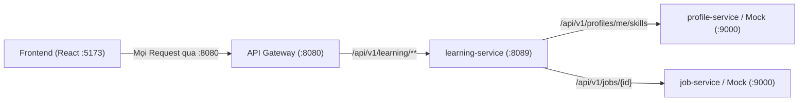

# Tài Liệu Đặc Tả API - Module Đào Tạo Bổ Sung (DT-01)

> **Dự án**: Rikkei Jobs  
> **Module**: Đào tạo bổ sung · DT-01 (Phân tích khoảng thiếu hụt năng lực theo JD và vị trí mục tiêu)  
> **Cổng API Gateway chính thức**: `http://localhost:8080`  
> **Cổng Learning Service nội bộ**: `http://localhost:8089`  
> **Cổng Mock Server dịch vụ ngoài**: `http://localhost:9000`  
> **Quy chuẩn phản hồi**: 100% tuân thủ Envelope Pattern `ApiResponse<T>` theo [docs/quy-chuan-api-response.md](../../docs/quy-chuan-api-response.md).

---

## 1. Quy Chuẩn Chung Cho Frontend

### 1.1. Cấu trúc Response Envelope (`ApiResponse<T>`)

Mọi phản hồi từ hệ thống (kể cả thành công 2xx, lỗi nghiệp vụ 4xx, hay lỗi máy chủ 5xx) đều có cấu trúc:

```json
{
  "success": true,
  "statusCode": 200,
  "message": "Thông báo kết quả thao tác bằng tiếng Việt thân thiện",
  "data": { ... },
  "timestamp": "2026-11-12T16:00:00.1234567"
}
```

- **`success`**: `true` khi HTTP status 2xx, `false` khi có lỗi.
- **`statusCode`**: Mã trạng thái HTTP chuẩn (`200`, `400`, `404`, `500`...).
- **`message`**: Thông điệp thông báo bằng tiếng Việt có thể hiển thị trực tiếp lên Toast / Alert của UI.
- **`data`**: Chứa dữ liệu trả về cho Frontend. Khi thao tác thất bại, trường này là `null` hoặc danh sách lỗi chi tiết.
- **`timestamp`**: Thời điểm máy chủ xử lý xong (ISO-8601).

### 1.2. Cơ chế truyền định danh người dùng & Phân quyền (Authentication & RBAC)

- Khi gọi qua **API Gateway (cổng 8080)**, Gateway giải mã JWT Bearer token và chuyển tiếp các header sau:
  - `X-User-Id`: ID định danh của người dùng (ví dụ: UUID hoặc mã ứng viên `cand-001`).
  - `X-User-Role`: Vai trò của người dùng từ hệ thống (`CANDIDATE`, `HR`, `MENTOR`, `STAFF`, `ADMIN`).
  - `Authorization`: Token `Bearer <JWT>` (được dùng để xác thực trực tiếp hoặc chuyển tiếp sang service ngoài).
- Đối với các API yêu cầu bảo mật (`/me/**`):
  - Nếu thiếu thông tin đăng nhập (`X-User-Id` và `Authorization` đều trống hoặc JWT không hợp lệ): Trả về **HTTP 401 Unauthorized**.
  - Nếu người dùng có vai trò không phải `CANDIDATE` (ví dụ `HR`, `MENTOR`, `STAFF`...): Trả về **HTTP 403 Forbidden**.

### 1.3. Bảng Tổng Hợp Phân Quyền API (Access Control Matrix)

| STT | Phương thức | Đường dẫn (Qua Gateway `:8080`)          | Mức độ bảo mật | Đối tượng / Vai trò được phép            | Mô tả quyền truy cập                                                                 |
| :-: | :---------: | :--------------------------------------- | :------------: | :--------------------------------------- | :----------------------------------------------------------------------------------- |
|  1  |    `GET`    | `/api/v1/learning/target-positions`      |   **Public**   | Tất cả (Khách chưa đăng nhập & mọi Role) | Xem danh mục 4 vị trí mục tiêu chuẩn và bộ kỹ năng tham khảo.                        |
|  2  |    `GET`    | `/api/v1/learning/target-positions/{id}` |   **Public**   | Tất cả (Khách chưa đăng nhập & mọi Role) | Xem chi tiết yêu cầu điểm sàn của một vị trí mục tiêu.                               |
|  3  |    `PUT`    | `/api/v1/learning/me/target`             |  **Bảo mật**   | Chỉ **`CANDIDATE`** (Ứng viên)           | Thiết lập hoặc thay đổi vị trí / JD mục tiêu cá nhân.                                |
|  4  |    `GET`    | `/api/v1/learning/me/target`             |  **Bảo mật**   | Chỉ **`CANDIDATE`** (Ứng viên)           | Lấy mục tiêu nghề nghiệp hiện tại của chính ứng viên đang đăng nhập.                 |
|  5  |    `GET`    | `/api/v1/learning/me/gap-analysis`       |  **Bảo mật**   | Chỉ **`CANDIDATE`** (Ứng viên)           | Phân tích khoảng thiếu hụt năng lực của chính ứng viên theo mục tiêu hoặc `?jobId=`. |

#### Phản hồi lỗi bảo mật chuẩn (HTTP 401 & HTTP 403):

- **HTTP 401 Unauthorized** (Chưa đăng nhập / Thiếu Token):

```json
{
  "success": false,
  "statusCode": 401,
  "message": "Vui lòng đăng nhập để thực hiện thao tác này.",
  "data": null,
  "timestamp": "2026-11-12T16:20:00.1234567"
}
```

- **HTTP 403 Forbidden** (Sai vai trò, ví dụ HR/Mentor gọi API của Candidate):

```json
{
  "success": false,
  "statusCode": 403,
  "message": "Bạn không có quyền thực hiện thao tác này. Chức năng chỉ dành cho Ứng viên (CANDIDATE).",
  "data": null,
  "timestamp": "2026-11-12T16:20:00.1234567"
}
```

---

## 2. Danh Sách Chi Tiết Các API Mới



---

### API 1: Lấy danh sách các vị trí mục tiêu (Target Positions)

- **Mục đích**: Lấy danh sách 4 vị trí mục tiêu chuẩn hóa được hệ thống định nghĩa sẵn để đưa vào ô chọn (Dropdown / Select Box) trên giao diện ứng viên.
- **Phương thức HTTP**: `GET`
- **Đường dẫn qua Gateway**: `http://localhost:8080/api/v1/learning/target-positions`
- **Đường dẫn trực tiếp nội bộ**: `http://localhost:8089/api/v1/learning/target-positions`
- **Quyền hạn**: Public / Ứng viên (Không bắt buộc đăng nhập).

#### Request Headers:

```http
Accept: application/json
```

#### Response Mẫu (HTTP 200 OK):

```json
{
  "success": true,
  "statusCode": 200,
  "message": "Lấy danh sách vị trí mục tiêu thành công",
  "data": [
    {
      "id": "11111111-1111-1111-1111-111111111101",
      "code": "JAVA_BACKEND_FRESHER",
      "name": "Java Backend Fresher",
      "description": "Lộ trình đào tạo lập trình viên Java Backend Fresher chuyên sâu với Spring Boot, CSDL quan hệ và RESTful API.",
      "skills": [
        {
          "skillId": "JAVA_CORE",
          "skillName": "Java Core",
          "minScore": 75,
          "isMandatory": true
        },
        {
          "skillId": "SPRING_BOOT",
          "skillName": "Spring Boot",
          "minScore": 70,
          "isMandatory": true
        },
        {
          "skillId": "SQL",
          "skillName": "SQL",
          "minScore": 70,
          "isMandatory": true
        },
        {
          "skillId": "REST_API",
          "skillName": "REST API",
          "minScore": 70,
          "isMandatory": true
        },
        {
          "skillId": "GIT",
          "skillName": "Git",
          "minScore": 60,
          "isMandatory": false
        }
      ]
    },
    {
      "id": "11111111-1111-1111-1111-111111111102",
      "code": "FRONTEND_REACT_FRESHER",
      "name": "Frontend ReactJS Fresher",
      "description": "Lộ trình phát triển giao diện hiện đại với React 19, TypeScript và tối ưu UX/UI.",
      "skills": [ ... ]
    },
    {
      "id": "11111111-1111-1111-1111-111111111103",
      "code": "TESTER",
      "name": "Tester / QA QC Fresher",
      "description": "Lộ trình kiểm thử phần mềm chuyên nghiệp...",
      "skills": [ ... ]
    },
    {
      "id": "11111111-1111-1111-1111-111111111104",
      "code": "FULLSTACK",
      "name": "Fullstack Developer Fresher",
      "description": "Lộ trình đào tạo kỹ sư phát triển toàn diện cả Frontend React và Backend Spring Boot.",
      "skills": [ ... ]
    }
  ],
  "timestamp": "2026-11-12T16:05:00.1234567"
}
```

---

### API 2: Lấy chi tiết vị trí mục tiêu theo ID

- **Mục đích**: Xem chi tiết mô tả và bảng kỹ năng sàn của một vị trí mục tiêu cụ thể.
- **Phương thức HTTP**: `GET`
- **Đường dẫn qua Gateway**: `http://localhost:8080/api/v1/learning/target-positions/{id}`
- **Quyền hạn**: **Public** (Không bắt buộc đăng nhập; tất cả người dùng đều có quyền xem).
- **Tham số Path**: `id` - UUID của vị trí mục tiêu (ví dụ: `11111111-1111-1111-1111-111111111101`).

#### Response Mẫu (HTTP 200 OK):

```json
{
  "success": true,
  "statusCode": 200,
  "message": "Lấy chi tiết vị trí mục tiêu thành công",
  "data": {
    "id": "11111111-1111-1111-1111-111111111101",
    "code": "JAVA_BACKEND_FRESHER",
    "name": "Java Backend Fresher",
    "description": "Lộ trình đào tạo lập trình viên Java Backend Fresher chuyên sâu...",
    "skills": [
      {
        "skillId": "JAVA_CORE",
        "skillName": "Java Core",
        "minScore": 75,
        "isMandatory": true
      }
    ]
  },
  "timestamp": "2026-11-12T16:05:00.1234567"
}
```

---

### API 3: Thiết lập / Đổi mục tiêu nghề nghiệp của học viên

- **Mục đích**: Học viên chọn vị trí mục tiêu từ danh sách, hoặc chọn một tin tuyển dụng JD cụ thể để làm mục tiêu học tập lâu dài.
- **Phương thức HTTP**: `PUT`
- **Đường dẫn qua Gateway**: `http://localhost:8080/api/v1/learning/me/target`
- **Quyền hạn**: **Bảo mật (Authenticated)** — Chỉ vai trò **`CANDIDATE`** được phép truy cập (Thiếu đăng nhập -> `401`, sai vai trò -> `403`).
- **Quy tắc Request Body**: **Bắt buộc chọn đúng 1 trong 2 trường** (`positionId` hoặc `jobId`). Gửi đồng thời cả 2 hoặc để trống cả 2 sẽ trả về lỗi HTTP 400.

#### Request Headers:

```http
Content-Type: application/json
X-User-Id: cand-001
Authorization: Bearer <JWT_TOKEN>
```

#### Trường hợp 3A: Chọn theo Vị trí mục tiêu (Position):

```json
{
  "positionId": "11111111-1111-1111-1111-111111111101"
}
```

#### Trường hợp 3B: Chọn theo Tin tuyển dụng (Job JD):

```json
{
  "jobId": "job-001"
}
```

#### Response Mẫu (HTTP 200 OK):

```json
{
  "success": true,
  "statusCode": 200,
  "message": "Thiết lập mục tiêu nghề nghiệp thành công",
  "data": {
    "userId": "11111111-1111-1111-1111-111111111001",
    "targetType": "POSITION",
    "positionId": "11111111-1111-1111-1111-111111111101",
    "jobId": null,
    "targetName": "Java Backend Fresher",
    "chosenAt": "2026-11-12T16:05:15.123456Z"
  },
  "timestamp": "2026-11-12T16:05:15.1234567"
}
```

#### Response Lỗi Validation (HTTP 400 Bad Request):

Khi truyền cả 2 tham số hoặc không truyền:

```json
{
  "success": false,
  "statusCode": 400,
  "message": "Dữ liệu nhập vào không hợp lệ, vui lòng kiểm tra lại",
  "data": {
    "errors": [
      {
        "field": "valid",
        "message": "Phải chọn đúng một trong hai: positionId hoặc jobId"
      }
    ]
  },
  "timestamp": "2026-11-12T16:05:20.1234567"
}
```

---

### API 4: Lấy mục tiêu nghề nghiệp hiện tại của ứng viên

- **Mục đích**: Frontend gọi API này khi ứng viên tải trang `/candidate/learning` để khôi phục trạng thái mục tiêu đã chọn trước đó.
- **Phương thức HTTP**: `GET`
- **Đường dẫn qua Gateway**: `http://localhost:8080/api/v1/learning/me/target`
- **Quyền hạn**: **Bảo mật (Authenticated)** — Chỉ vai trò **`CANDIDATE`** được phép truy cập (Thiếu đăng nhập -> `401`, sai vai trò -> `403`).
- **Request Headers**: `X-User-Id: cand-001` (hoặc `Authorization: Bearer <token>`).

#### Response Mẫu khi đã có mục tiêu (HTTP 200 OK):

```json
{
  "success": true,
  "statusCode": 200,
  "message": "Lấy mục tiêu hiện tại thành công",
  "data": {
    "userId": "11111111-1111-1111-1111-111111111001",
    "targetType": "POSITION",
    "positionId": "11111111-1111-1111-1111-111111111101",
    "jobId": null,
    "targetName": "Java Backend Fresher",
    "chosenAt": "2026-11-12T16:05:15.123456Z"
  },
  "timestamp": "2026-11-12T16:05:30.1234567"
}
```

#### Response Mẫu khi chưa chọn mục tiêu (HTTP 200 OK):

```json
{
  "success": true,
  "statusCode": 200,
  "message": "Chưa thiết lập mục tiêu",
  "data": null,
  "timestamp": "2026-11-12T16:05:30.1234567"
}
```

---

### API 5: Phân tích khoảng thiếu hụt năng lực (Gap Analysis Engine)

- **Mục đích**: So sánh hồ sơ năng lực thực tế của ứng viên (`verified_score`) với bộ kỹ năng yêu cầu của Vị trí mục tiêu hoặc của JD tuyển dụng.
- **Phương thức HTTP**: `GET`
- **Đường dẫn qua Gateway**:
  - **Kịch bản A (Theo mục tiêu đã lưu)**: `http://localhost:8080/api/v1/learning/me/gap-analysis`
  - **Kịch bản B (So sánh tức thời khi bấm nút "Phân tích so với JD này" ở chi tiết JD)**: `http://localhost:8080/api/v1/learning/me/gap-analysis?jobId=job-001`
- **Quyền hạn**: **Bảo mật (Authenticated)** — Chỉ vai trò **`CANDIDATE`** được phép truy cập (Thiếu đăng nhập -> `401`, sai vai trò -> `403`).
- **Tham số Query**: `jobId` _(không bắt buộc)_ - Khi có tham số này, hệ thống sẽ bỏ qua mục tiêu đã lưu và phân tích tức thời dựa trên `min_score` của tin tuyển dụng đó.
- **Request Headers**: `X-User-Id: cand-001`, `Authorization: Bearer <token>`.

#### Quy tắc nghiệp vụ phân tích:

1. **Điểm hiện tại (`current`)**: Lấy từ `verified_score` (điểm đã kiểm chứng qua LMS/Khảo thí). Nếu ứng viên chưa có kỹ năng thì `current = 0`.
2. **Loại trừ kỹ năng đạt**: Các kỹ năng có điểm `current >= required` (tức là `gap <= 0`) **không xuất hiện** trong mảng `items`.
3. **Độ ưu tiên (`priority`)**:
   - `HIGH`: Kỹ năng bắt buộc (`isMandatory == true`) **VÀ** thiếu > 20 điểm (`gap > 20`).
   - `MEDIUM`: Thiếu > 10 điểm (`gap > 10`).
   - `LOW`: Các trường hợp còn lại (`gap <= 10`).
4. **Tỷ lệ sẵn sàng (`readiness`)**: `% kỹ năng đạt = (số kỹ năng đạt / tổng số kỹ năng yêu cầu) * 100%`.
5. **Sắp xếp**: Mảng `items` sắp xếp theo `gap` giảm dần (kỹ năng thiếu nhiều điểm nhất lên đầu).
6. **Lưu trữ snapshot**: Kết quả được tự động cập nhật vào bảng `gap_results` trong cơ sở dữ liệu.

#### Response Mẫu (HTTP 200 OK):

```json
{
  "success": true,
  "statusCode": 200,
  "message": "Phân tích khoảng thiếu hụt năng lực thành công",
  "data": {
    "target": {
      "type": "POSITION",
      "id": "11111111-1111-1111-1111-111111111101",
      "code": "JAVA_BACKEND_FRESHER",
      "name": "Java Backend Fresher",
      "description": "Lộ trình đào tạo lập trình viên Java Backend Fresher chuyên sâu với Spring Boot, CSDL quan hệ và RESTful API."
    },
    "readiness": 80.0,
    "totalRequiredSkills": 5,
    "passedSkillsCount": 4,
    "missingSkillsCount": 1,
    "computedAt": "2026-11-12T16:05:45.123456Z",
    "items": [
      {
        "skillId": "REST_API",
        "skill": "REST API",
        "skillName": "REST API",
        "required": 70,
        "current": 0,
        "gap": 70,
        "priority": "HIGH",
        "isMandatory": true
      }
    ]
  },
  "timestamp": "2026-11-12T16:05:45.1234567"
}
```

---

## 3. Hướng Dẫn Frontend Tích Hợp (React SPA)

### 3.1. Cấu hình Axios / API Client trong Frontend:

```typescript
import axios from "axios";

// Luôn gọi qua API Gateway cổng 8080 (hoặc qua Vite Proxy /api)
export const apiClient = axios.create({
  baseURL: import.meta.env.VITE_API_GATEWAY_URL || "http://localhost:8080",
  headers: {
    "Content-Type": "application/json",
  },
});

// Interceptor đính kèm Token và X-User-Id
apiClient.interceptors.request.use((config) => {
  const token = localStorage.getItem("token");
  const userId = localStorage.getItem("userId") || "cand-001";
  if (token) {
    config.headers.Authorization = `Bearer ${token}`;
  }
  if (userId) {
    config.headers["X-User-Id"] = userId;
  }
  return config;
});
```

### 3.2. Typescript Interfaces tương ứng:

```typescript
export interface ApiResponse<T> {
  success: boolean;
  statusCode: number;
  message: string;
  data: T;
  timestamp: string;
}

export type GapPriority = "HIGH" | "MEDIUM" | "LOW";

export interface GapItem {
  skillId: string;
  skill: string;
  skillName: string;
  required: number;
  current: number;
  gap: number;
  priority: GapPriority;
  isMandatory: boolean;
}

export interface GapAnalysisData {
  target: {
    type: "POSITION" | "JOB";
    id: string;
    code: string;
    name: string;
    description: string;
  };
  readiness: number;
  totalRequiredSkills: number;
  passedSkillsCount: number;
  missingSkillsCount: number;
  computedAt: string;
  items: GapItem[];
}
```

### 3.3. Hiển thị UI theo kết quả:

- **Thanh đo độ sẵn sàng (Readiness Bar)**: Sử dụng trường `data.readiness` (giá trị 0 - 100%).
- **Bảng kỹ năng thiếu**: Render mảng `data.items` theo các cột:
  - **Kỹ năng**: `item.skill`
  - **Điểm yêu cầu**: `item.required`
  - **Điểm hiện tại**: `item.current`
  - **Điểm thiếu hụt**: `+item.gap`
  - **Độ ưu tiên**:
    - `HIGH`: Badge màu đỏ (Nguy cấp - Cần học ngay)
    - `MEDIUM`: Badge màu vàng/cam (Cần cải thiện)
    - `LOW`: Badge màu xanh/xám (Mức độ nhẹ)
- **Nút "Phân tích so với JD này" trên trang Chi tiết JD**:
  Gọi `GET /api/v1/learning/me/gap-analysis?jobId=${jobId}` và hiển thị modal hoặc chuyển hướng sang tab Phân tích năng lực với tham số `jobId`.

---

## 4. Hướng Dẫn Kiểm Thử Bằng cURL Qua API Gateway (Cổng 8080)

### 1. Lấy danh sách 4 vị trí mục tiêu:

```bash
curl -X GET "http://localhost:8080/api/v1/learning/target-positions"
```

### 2. Thiết lập mục tiêu là Java Backend Fresher:

```bash
curl -X PUT "http://localhost:8080/api/v1/learning/me/target" \
  -H "Content-Type: application/json" \
  -H "X-User-Id: cand-001" \
  -H "X-User-Role: CANDIDATE" \
  -d '{"positionId": "11111111-1111-1111-1111-111111111101"}'
```

### 3. Lấy mục tiêu hiện tại của ứng viên:

```bash
curl -X GET "http://localhost:8080/api/v1/learning/me/target" \
  -H "X-User-Id: cand-001" \
  -H "X-User-Role: CANDIDATE"
```

### 4. Chạy phân tích khoảng thiếu hụt theo mục tiêu đã chọn:

```bash
curl -X GET "http://localhost:8080/api/v1/learning/me/gap-analysis" \
  -H "X-User-Id: cand-001" \
  -H "X-User-Role: CANDIDATE"
```

### 5. Chạy phân tích tức thời so sánh với JD tuyển dụng (nút "Phân tích so với JD này"):

```bash
curl -X GET "http://localhost:8080/api/v1/learning/me/gap-analysis?jobId=job-001" \
  -H "X-User-Id: cand-001" \
  -H "X-User-Role: CANDIDATE"
```

### 6. Kiểm thử phân quyền (401 Unauthorized & 403 Forbidden):

```bash
# Thiếu thông tin đăng nhập -> HTTP 401
curl -X GET "http://localhost:8080/api/v1/learning/me/gap-analysis"

# Sai vai trò (HR gọi API của CANDIDATE) -> HTTP 403
curl -X GET "http://localhost:8080/api/v1/learning/me/gap-analysis" \
  -H "X-User-Id: hr-001" \
  -H "X-User-Role: HR"
```
