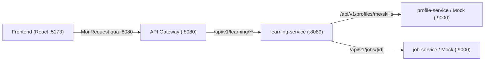
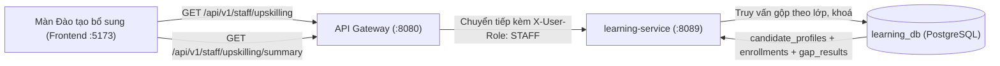

# Tài Liệu Đặc Tả API - Module Đào Tạo Bổ Sung (DT-01, DT-02, DT-03 & DT-04)

> **Dự án**: Rikkei Jobs  
> **Module**: Đào tạo bổ sung · DT-01 (Phân tích khoảng thiếu hụt năng lực), DT-02 (Gợi ý khóa học LMS, ghi danh, theo dõi), DT-03 (Màn khoảng thiếu hụt và lộ trình bổ sung) & DT-04 (Cán bộ theo dõi đào tạo bổ sung theo lớp, khoá)  
> **Cổng API Gateway chính thức**: `http://localhost:8080`  
> **Cổng Learning Service nội bộ**: `http://localhost:8089`  
> **Cổng Mock Server dịch vụ ngoài**: `http://localhost:9000`  
> **Quy chuẩn phản hồi**: 100% tuân thủ Envelope Pattern `ApiResponse<T>` theo [docs/quy-chuan-api-response.md](../../docs/quy-chuan-api-response.md).

---

## 1. Quy Chuẩn Chung Cho Frontend

### 1.1. Cấu trúc Response Envelope (`ApiResponse<T>`)

Mọi phản hồi từ hệ thống (kể cả thành công 2xx, lỗi nghiệp vụ 4xx, hay lỗi máy chủ 5xx) đều có cấu trúc:

```json
{
  "success": true,
  "statusCode": 200,
  "message": "Thông báo kết quả thao tác bằng tiếng Việt thân thiện",
  "data": { ... },
  "timestamp": "2026-11-12T16:00:00.1234567"
}
```

- **`success`**: `true` khi HTTP status 2xx, `false` khi có lỗi.
- **`statusCode`**: Mã trạng thái HTTP chuẩn (`200`, `400`, `404`, `500`...).
- **`message`**: Thông điệp thông báo bằng tiếng Việt có thể hiển thị trực tiếp lên Toast / Alert của UI.
- **`data`**: Chứa dữ liệu trả về cho Frontend. Khi thao tác thất bại, trường này là `null` hoặc danh sách lỗi chi tiết.
- **`timestamp`**: Thời điểm máy chủ xử lý xong (ISO-8601).

### 1.2. Cơ chế truyền định danh người dùng & Phân quyền (Authentication & RBAC)

- Khi gọi qua **API Gateway (cổng 8080)**, Gateway giải mã JWT Bearer token và chuyển tiếp các header sau:
  - `X-User-Id`: ID định danh của người dùng (ví dụ: UUID hoặc mã ứng viên `cand-001`).
  - `X-User-Role`: Vai trò của người dùng từ hệ thống (`CANDIDATE`, `HR`, `MENTOR`, `STAFF`, `ADMIN`).
  - `Authorization`: Token `Bearer <JWT>` (được dùng để xác thực trực tiếp hoặc chuyển tiếp sang service ngoài).
- Đối với các API yêu cầu bảo mật của Ứng viên (`/me/**`):
  - Nếu thiếu thông tin đăng nhập (`X-User-Id` và `Authorization` đều trống hoặc JWT không hợp lệ): Trả về **HTTP 401 Unauthorized**.
  - Nếu người dùng có vai trò không phải `CANDIDATE` (ví dụ `HR`, `MENTOR`, `STAFF`...): Trả về **HTTP 403 Forbidden**.
- Đối với các API theo dõi đào tạo của Cán bộ (`/staff/upskilling/**`, DT-04):
  - Yêu cầu vai trò **`STAFF`** hoặc **`ADMIN`**.
  - Nếu người dùng gọi bằng vai trò `HR` hoặc `CANDIDATE`: Trả về **HTTP 403 Forbidden** (AC-4).
  - Nếu thiếu thông tin đăng nhập hoặc JWT không hợp lệ: Trả về **HTTP 401 Unauthorized**.

### 1.3. Bảng Tổng Hợp Phân Quyền API (Access Control Matrix)

| STT | Phương thức | Đường dẫn (Qua Gateway `:8080`)           | Mức độ bảo mật | Đối tượng / Vai trò được phép            | Mô tả quyền truy cập                                                                 |
| :-: | :---------: | :---------------------------------------- | :------------: | :--------------------------------------- | :----------------------------------------------------------------------------------- |
|  1  |    `GET`    | `/api/v1/learning/target-positions`       |   **Public**   | Tất cả (Khách chưa đăng nhập & mọi Role) | Xem danh mục 4 vị trí mục tiêu chuẩn và bộ kỹ năng tham khảo.                        |
|  2  |    `GET`    | `/api/v1/learning/target-positions/{id}`  |   **Public**   | Tất cả (Khách chưa đăng nhập & mọi Role) | Xem chi tiết yêu cầu điểm sàn của một vị trí mục tiêu.                               |
|  3  |    `PUT`    | `/api/v1/learning/me/target`              |  **Bảo mật**   | Chỉ **`CANDIDATE`** (Ứng viên)           | Thiết lập hoặc thay đổi vị trí / JD mục tiêu cá nhân; tự động archive lộ trình cũ.    |
|  4  |    `GET`    | `/api/v1/learning/me/target`              |  **Bảo mật**   | Chỉ **`CANDIDATE`** (Ứng viên)           | Lấy mục tiêu nghề nghiệp hiện tại của chính ứng viên đang đăng nhập.                 |
|  5  |    `GET`    | `/api/v1/learning/me/gap-analysis`        |  **Bảo mật**   | Chỉ **`CANDIDATE`** (Ứng viên)           | Phân tích khoảng thiếu hụt năng lực của chính ứng viên theo mục tiêu hoặc `?jobId=`. |
|  6  |    `GET`    | `/api/v1/learning/me/course-suggestions`  |  **Bảo mật**   | Chỉ **`CANDIDATE`** (Ứng viên)           | Gợi ý danh sách khóa học LMS theo từng kỹ năng thiếu và cấp độ hiện tại (DT-02).     |
|  7  |   `POST`    | `/api/v1/learning/me/enrollments`         |  **Bảo mật**   | Chỉ **`CANDIDATE`** (Ứng viên)           | Ghi danh khóa học bổ sung trên LMS; chặn trùng lặp 409; LMS lỗi thì không lưu.       |
|  8  |    `GET`    | `/api/v1/learning/me/enrollments`         |  **Bảo mật**   | Chỉ **`CANDIDATE`** (Ứng viên)           | Xem danh sách các khóa học ứng viên đã ghi danh kèm tiến độ và điểm số.              |
|  9  |   `POST`    | `/api/v1/learning/me/enrollments/refresh` |  **Bảo mật**   | Chỉ **`CANDIDATE`** (Ứng viên)           | Làm mới tiến độ và điểm số từ LMS; tự động cập nhật tăng chỉ số và chuyển DONE step. |
| 10  |   `POST`    | `/api/v1/learning/me/learning-path`       |  **Bảo mật**   | Chỉ **`CANDIDATE`** (Ứng viên)           | Sinh lộ trình học tập tối ưu từ phân tích Gap (DT-01) và khóa học gợi ý (DT-02). Kỹ năng bắt buộc trước, gap lớn trước. Lộ trình cũ ACTIVE chuyển ARCHIVED. (DT-03) |
| 11  |    `GET`    | `/api/v1/learning/me/learning-path`       |  **Bảo mật**   | Chỉ **`CANDIDATE`** (Ứng viên)           | Lấy thông tin lộ trình ACTIVE, danh sách bước học, % hoàn thành và mức tăng trưởng sẵn sàng. Tự động chuyển DONE khi môn học COMPLETED. (DT-03) |
| 12  |    `GET`    | `/api/v1/staff/upskilling`                |  **Bảo mật**   | Chỉ **`STAFF`**, **`ADMIN`** (Cán bộ)    | Cán bộ theo dõi danh sách đào tạo bổ sung theo lớp, khoá; lọc trạng thái, kỹ năng thiếu; phân trang (DT-04) |
| 13  |    `GET`    | `/api/v1/staff/upskilling/summary`        |  **Bảo mật**   | Chỉ **`STAFF`**, **`ADMIN`** (Cán bộ)    | Báo cáo tổng hợp đào tạo bổ sung: số ứng viên đang học, đã hoàn thành, Top 5 kỹ năng bị thiếu nhiều nhất (DT-04) |
| 14  |    `GET`    | `/api/v1/staff/upskilling/export`         |  **Bảo mật**   | Chỉ **`STAFF`**, **`ADMIN`** (Cán bộ)    | Xuất báo cáo danh sách đào tạo bổ sung ra tệp Excel (`.xlsx`) theo đúng bộ lọc hiện tại (DT-04) |

#### Phản hồi lỗi bảo mật chuẩn (HTTP 401 & HTTP 403):

- **HTTP 401 Unauthorized** (Chưa đăng nhập / Thiếu Token):

```json
{
  "success": false,
  "statusCode": 401,
  "message": "Vui lòng đăng nhập để thực hiện thao tác này.",
  "data": null,
  "timestamp": "2026-11-12T16:20:00.1234567"
}
```

- **HTTP 403 Forbidden** (Sai vai trò, ví dụ HR/Mentor gọi API của Candidate):

```json
{
  "success": false,
  "statusCode": 403,
  "message": "Bạn không có quyền thực hiện thao tác này. Chức năng chỉ dành cho Ứng viên (CANDIDATE).",
  "data": null,
  "timestamp": "2026-11-12T16:20:00.1234567"
}
```

---

## 2. Danh Sách Chi Tiết Các API Mới



---

### API 1: Lấy danh sách các vị trí mục tiêu (Target Positions)

- **Mục đích**: Lấy danh sách 4 vị trí mục tiêu chuẩn hóa được hệ thống định nghĩa sẵn để đưa vào ô chọn (Dropdown / Select Box) trên giao diện ứng viên.
- **Phương thức HTTP**: `GET`
- **Đường dẫn qua Gateway**: `http://localhost:8080/api/v1/learning/target-positions`
- **Đường dẫn trực tiếp nội bộ**: `http://localhost:8089/api/v1/learning/target-positions`
- **Quyền hạn**: Public / Ứng viên (Không bắt buộc đăng nhập).

#### Request Headers:

```http
Accept: application/json
```

#### Response Mẫu (HTTP 200 OK):

```json
{
  "success": true,
  "statusCode": 200,
  "message": "Lấy danh sách vị trí mục tiêu thành công",
  "data": [
    {
      "id": "11111111-1111-1111-1111-111111111101",
      "code": "JAVA_BACKEND_FRESHER",
      "name": "Java Backend Fresher",
      "description": "Lộ trình đào tạo lập trình viên Java Backend Fresher chuyên sâu với Spring Boot, CSDL quan hệ và RESTful API.",
      "skills": [
        {
          "skillId": "JAVA_CORE",
          "skillName": "Java Core",
          "minScore": 75,
          "isMandatory": true
        },
        {
          "skillId": "SPRING_BOOT",
          "skillName": "Spring Boot",
          "minScore": 70,
          "isMandatory": true
        },
        {
          "skillId": "SQL",
          "skillName": "SQL",
          "minScore": 70,
          "isMandatory": true
        },
        {
          "skillId": "REST_API",
          "skillName": "REST API",
          "minScore": 70,
          "isMandatory": true
        },
        {
          "skillId": "GIT",
          "skillName": "Git",
          "minScore": 60,
          "isMandatory": false
        }
      ]
    },
    {
      "id": "11111111-1111-1111-1111-111111111102",
      "code": "FRONTEND_REACT_FRESHER",
      "name": "Frontend ReactJS Fresher",
      "description": "Lộ trình phát triển giao diện hiện đại với React 19, TypeScript và tối ưu UX/UI.",
      "skills": [ ... ]
    },
    {
      "id": "11111111-1111-1111-1111-111111111103",
      "code": "TESTER",
      "name": "Tester / QA QC Fresher",
      "description": "Lộ trình kiểm thử phần mềm chuyên nghiệp...",
      "skills": [ ... ]
    },
    {
      "id": "11111111-1111-1111-1111-111111111104",
      "code": "FULLSTACK",
      "name": "Fullstack Developer Fresher",
      "description": "Lộ trình đào tạo kỹ sư phát triển toàn diện cả Frontend React và Backend Spring Boot.",
      "skills": [ ... ]
    }
  ],
  "timestamp": "2026-11-12T16:05:00.1234567"
}
```

---

### API 2: Lấy chi tiết vị trí mục tiêu theo ID

- **Mục đích**: Xem chi tiết mô tả và bảng kỹ năng sàn của một vị trí mục tiêu cụ thể.
- **Phương thức HTTP**: `GET`
- **Đường dẫn qua Gateway**: `http://localhost:8080/api/v1/learning/target-positions/{id}`
- **Quyền hạn**: **Public** (Không bắt buộc đăng nhập; tất cả người dùng đều có quyền xem).
- **Tham số Path**: `id` - UUID của vị trí mục tiêu (ví dụ: `11111111-1111-1111-1111-111111111101`).

#### Response Mẫu (HTTP 200 OK):

```json
{
  "success": true,
  "statusCode": 200,
  "message": "Lấy chi tiết vị trí mục tiêu thành công",
  "data": {
    "id": "11111111-1111-1111-1111-111111111101",
    "code": "JAVA_BACKEND_FRESHER",
    "name": "Java Backend Fresher",
    "description": "Lộ trình đào tạo lập trình viên Java Backend Fresher chuyên sâu...",
    "skills": [
      {
        "skillId": "JAVA_CORE",
        "skillName": "Java Core",
        "minScore": 75,
        "isMandatory": true
      }
    ]
  },
  "timestamp": "2026-11-12T16:05:00.1234567"
}
```

---

### API 3: Thiết lập / Đổi mục tiêu nghề nghiệp của học viên

- **Mục đích**: Học viên chọn vị trí mục tiêu từ danh sách, hoặc chọn một tin tuyển dụng JD cụ thể để làm mục tiêu học tập lâu dài.
- **Phương thức HTTP**: `PUT`
- **Đường dẫn qua Gateway**: `http://localhost:8080/api/v1/learning/me/target`
- **Quyền hạn**: **Bảo mật (Authenticated)** — Chỉ vai trò **`CANDIDATE`** được phép truy cập (Thiếu đăng nhập -> `401`, sai vai trò -> `403`).
- **Quy tắc Request Body**: **Bắt buộc chọn đúng 1 trong 2 trường** (`positionId` hoặc `jobId`). Gửi đồng thời cả 2 hoặc để trống cả 2 sẽ trả về lỗi HTTP 400.

#### Request Headers:

```http
Content-Type: application/json
X-User-Id: cand-001
Authorization: Bearer <JWT_TOKEN>
```

#### Trường hợp 3A: Chọn theo Vị trí mục tiêu (Position):

```json
{
  "positionId": "11111111-1111-1111-1111-111111111101"
}
```

#### Trường hợp 3B: Chọn theo Tin tuyển dụng (Job JD):

```json
{
  "jobId": "job-001"
}
```

#### Response Mẫu (HTTP 200 OK):

```json
{
  "success": true,
  "statusCode": 200,
  "message": "Thiết lập mục tiêu nghề nghiệp thành công",
  "data": {
    "userId": "11111111-1111-1111-1111-111111111001",
    "targetType": "POSITION",
    "positionId": "11111111-1111-1111-1111-111111111101",
    "jobId": null,
    "targetName": "Java Backend Fresher",
    "chosenAt": "2026-11-12T16:05:15.123456Z"
  },
  "timestamp": "2026-11-12T16:05:15.1234567"
}
```

#### Response Lỗi Validation (HTTP 400 Bad Request):

Khi truyền cả 2 tham số hoặc không truyền:

```json
{
  "success": false,
  "statusCode": 400,
  "message": "Dữ liệu nhập vào không hợp lệ, vui lòng kiểm tra lại",
  "data": {
    "errors": [
      {
        "field": "valid",
        "message": "Phải chọn đúng một trong hai: positionId hoặc jobId"
      }
    ]
  },
  "timestamp": "2026-11-12T16:05:20.1234567"
}
```

---

### API 4: Lấy mục tiêu nghề nghiệp hiện tại của ứng viên

- **Mục đích**: Frontend gọi API này khi ứng viên tải trang `/candidate/learning` để khôi phục trạng thái mục tiêu đã chọn trước đó.
- **Phương thức HTTP**: `GET`
- **Đường dẫn qua Gateway**: `http://localhost:8080/api/v1/learning/me/target`
- **Quyền hạn**: **Bảo mật (Authenticated)** — Chỉ vai trò **`CANDIDATE`** được phép truy cập (Thiếu đăng nhập -> `401`, sai vai trò -> `403`).
- **Request Headers**: `X-User-Id: cand-001` (hoặc `Authorization: Bearer <token>`).

#### Response Mẫu khi đã có mục tiêu (HTTP 200 OK):

```json
{
  "success": true,
  "statusCode": 200,
  "message": "Lấy mục tiêu hiện tại thành công",
  "data": {
    "userId": "11111111-1111-1111-1111-111111111001",
    "targetType": "POSITION",
    "positionId": "11111111-1111-1111-1111-111111111101",
    "jobId": null,
    "targetName": "Java Backend Fresher",
    "chosenAt": "2026-11-12T16:05:15.123456Z"
  },
  "timestamp": "2026-11-12T16:05:30.1234567"
}
```

#### Response Mẫu khi chưa chọn mục tiêu (HTTP 200 OK):

```json
{
  "success": true,
  "statusCode": 200,
  "message": "Chưa thiết lập mục tiêu",
  "data": null,
  "timestamp": "2026-11-12T16:05:30.1234567"
}
```

---

### API 5: Phân tích khoảng thiếu hụt năng lực (Gap Analysis Engine)

- **Mục đích**: So sánh hồ sơ năng lực thực tế của ứng viên (`verified_score`) với bộ kỹ năng yêu cầu của Vị trí mục tiêu hoặc của JD tuyển dụng.
- **Phương thức HTTP**: `GET`
- **Đường dẫn qua Gateway**:
  - **Kịch bản A (Theo mục tiêu đã lưu)**: `http://localhost:8080/api/v1/learning/me/gap-analysis`
  - **Kịch bản B (So sánh tức thời khi bấm nút "Phân tích so với JD này" ở chi tiết JD)**: `http://localhost:8080/api/v1/learning/me/gap-analysis?jobId=job-001`
- **Quyền hạn**: **Bảo mật (Authenticated)** — Chỉ vai trò **`CANDIDATE`** được phép truy cập (Thiếu đăng nhập -> `401`, sai vai trò -> `403`).
- **Tham số Query**: `jobId` _(không bắt buộc)_ - Khi có tham số này, hệ thống sẽ bỏ qua mục tiêu đã lưu và phân tích tức thời dựa trên `min_score` của tin tuyển dụng đó.
- **Request Headers**: `X-User-Id: cand-001`, `Authorization: Bearer <token>`.

#### Quy tắc nghiệp vụ phân tích:

1. **Điểm hiện tại (`current`)**: Lấy từ `verified_score` (điểm đã kiểm chứng qua LMS/Khảo thí). Nếu ứng viên chưa có kỹ năng thì `current = 0`.
2. **Loại trừ kỹ năng đạt**: Các kỹ năng có điểm `current >= required` (tức là `gap <= 0`) **không xuất hiện** trong mảng `items`.
3. **Độ ưu tiên (`priority`)**:
   - `HIGH`: Kỹ năng bắt buộc (`isMandatory == true`) **VÀ** thiếu > 20 điểm (`gap > 20`).
   - `MEDIUM`: Thiếu > 10 điểm (`gap > 10`).
   - `LOW`: Các trường hợp còn lại (`gap <= 10`).
4. **Tỷ lệ sẵn sàng (`readiness`)**: `% kỹ năng đạt = (số kỹ năng đạt / tổng số kỹ năng yêu cầu) * 100%`.
5. **Sắp xếp**: Mảng `items` sắp xếp theo `gap` giảm dần (kỹ năng thiếu nhiều điểm nhất lên đầu).
6. **Lưu trữ snapshot**: Kết quả được tự động cập nhật vào bảng `gap_results` trong cơ sở dữ liệu.

#### Response Mẫu (HTTP 200 OK):

```json
{
  "success": true,
  "statusCode": 200,
  "message": "Phân tích khoảng thiếu hụt năng lực thành công",
  "data": {
    "target": {
      "type": "POSITION",
      "id": "11111111-1111-1111-1111-111111111101",
      "code": "JAVA_BACKEND_FRESHER",
      "name": "Java Backend Fresher",
      "description": "Lộ trình đào tạo lập trình viên Java Backend Fresher chuyên sâu với Spring Boot, CSDL quan hệ và RESTful API."
    },
    "readiness": 80.0,
    "totalRequiredSkills": 5,
    "passedSkillsCount": 4,
    "missingSkillsCount": 1,
    "computedAt": "2026-11-12T16:05:45.123456Z",
    "items": [
      {
        "skillId": "REST_API",
        "skill": "REST API",
        "skillName": "REST API",
        "required": 70,
        "current": 0,
        "gap": 70,
        "priority": "HIGH",
        "isMandatory": true
      }
    ]
  },
  "timestamp": "2026-11-12T16:05:45.1234567"
}
```

---

### API 6: Gợi ý khóa học bổ sung trên LMS theo từng kỹ năng thiếu (DT-02)

- **Mục đích**: Gợi ý các khóa học LMS phù hợp cho từng kỹ năng bị thiếu hụt (từ kết quả phân tích DT-01), lọc theo trình độ/thang điểm hiện tại của ứng viên (`level_from` $\le$ `currentScore` $\le$ `level_to`).
- **Phương thức HTTP**: `GET`
- **Đường dẫn qua Gateway**: `http://localhost:8080/api/v1/learning/me/course-suggestions`
- **Đường dẫn trực tiếp nội bộ**: `http://localhost:8089/api/v1/learning/me/course-suggestions` (hỗ trợ cả `/me/course-suggestions`)
- **Quyền hạn**: **Bảo mật (Authenticated)** — Chỉ vai trò **`CANDIDATE`** được phép truy cập.
- **Request Headers**: `X-User-Id: cand-001`, `Authorization: Bearer <token>`.

#### Quy tắc nghiệp vụ gợi ý:

1. Lấy danh sách kỹ năng bị thiếu hụt (`gap > 0`) từ kết quả phân tích mục tiêu hiện tại (DT-01).
2. Tra cứu bảng ánh xạ `skill_course_mappings` để tìm các khóa học tương ứng cho từng kỹ năng.
3. Lọc theo trình độ hiện tại của ứng viên: Chọn khóa học có khung điểm phù hợp (`currentScore` nằm giữa `level_from` và `level_to`).
4. Đính kèm trạng thái ghi danh thực tế của học viên từ bảng `enrollments`:
   - Nếu đã ghi danh: `isEnrolled = true`, hiển thị `enrollmentStatus` (`ENROLLED`, `IN_PROGRESS`, `COMPLETED`), `progress` (%), và `score`.
   - Nếu chưa ghi danh: `isEnrolled = false`, `enrollmentStatus = null`.

#### Response Mẫu (HTTP 200 OK):

```json
{
  "success": true,
  "statusCode": 200,
  "message": "Lấy danh sách khóa học gợi ý thành công",
  "data": [
    {
      "skillId": "JAVA_CORE",
      "skillName": "Java Core",
      "requiredScore": 75,
      "currentScore": 60,
      "gap": 15,
      "priority": "MEDIUM",
      "courses": [
        {
          "lmsCourseId": "CRS-01",
          "courseName": "Lập trình Spring Boot nâng cao & Microservices",
          "lessonHint": "Bài 1-3: Ôn tập OOP, Concurrency & Stream API nâng cao",
          "levelFrom": 0,
          "levelTo": 75,
          "level": "Tốt",
          "isEnrolled": true,
          "enrollmentId": "9b1deb4d-3b7d-4bad-9bdd-2b0d7b3dcb6d",
          "enrollmentStatus": "IN_PROGRESS",
          "progress": 45.0,
          "score": null,
          "enrolledAt": "2026-11-17T08:00:00Z",
          "completedAt": null
        },
        {
          "lmsCourseId": "CRS-05",
          "courseName": "Kiểm thử tự động & Chất lượng phần mềm",
          "lessonHint": "Bài 2-4: Unit Test Java với JUnit 5 và Mockito",
          "levelFrom": 0,
          "levelTo": 80,
          "level": "Tốt",
          "isEnrolled": false,
          "enrollmentId": null,
          "enrollmentStatus": null,
          "progress": null,
          "score": null,
          "enrolledAt": null,
          "completedAt": null
        }
      ]
    }
  ],
  "timestamp": "2026-11-17T15:30:00.1234567"
}
```

---

### API 7: Ghi danh khóa học bổ sung trên LMS (DT-02)

- **Mục đích**: Ứng viên đăng ký tham gia một khóa học được gợi ý trên hệ thống LMS.
- **Phương thức HTTP**: `POST`
- **Đường dẫn qua Gateway**: `http://localhost:8080/api/v1/learning/me/enrollments`
- **Đường dẫn trực tiếp nội bộ**: `http://localhost:8089/api/v1/learning/me/enrollments` (hỗ trợ cả `/me/enrollments`)
- **Quyền hạn**: **Bảo mật (Authenticated)** — Chỉ vai trò **`CANDIDATE`**.
- **Request Headers**: `Content-Type: application/json`, `X-User-Id: cand-001`, `Authorization: Bearer <token>`.

#### Request Body:

```json
{
  "lmsCourseId": "CRS-01",
  "skillId": "JAVA_CORE"
}
```

#### Quy tắc xử lý & Nghiệm thu:

1. **Kiểm tra trùng lặp (AC2)**:
   - Nếu ứng viên đã từng ghi danh khóa học này trong bảng `enrollments`, hệ thống từ chối và trả về ngay **HTTP 409 Conflict**.
2. **Gọi Mock LMS POST /lms/enrollments (AC4)**:
   - Hệ thống gọi sang Mock LMS kèm header `X-Service-Key`.
   - Nếu Mock LMS phản hồi lỗi 5xx hoặc không kết nối được: Trả về **HTTP 502 Bad Gateway**, **tuyệt đối không lưu bản ghi vào CSDL**.
3. **Lưu trữ CSDL**:
   - Khi Mock LMS thành công: Tạo bản ghi vào bảng `enrollments` với trạng thái `IN_PROGRESS`, `progress = 0.00`, thời gian ghi danh hiện tại.

#### Response Thành Công (HTTP 201 Created):

```json
{
  "success": true,
  "statusCode": 201,
  "message": "Ghi danh khóa học thành công",
  "data": {
    "id": "9b1deb4d-3b7d-4bad-9bdd-2b0d7b3dcb6d",
    "userId": "11111111-1111-1111-1111-111111111111",
    "lmsCourseId": "CRS-01",
    "courseName": "Lập trình Spring Boot nâng cao & Microservices",
    "skillId": "JAVA_CORE",
    "status": "IN_PROGRESS",
    "progress": 0.0,
    "score": null,
    "enrolledAt": "2026-11-17T15:35:00.123456Z",
    "completedAt": null
  },
  "timestamp": "2026-11-17T15:35:00.1234567"
}
```

#### Response Lỗi Trùng Lặp (HTTP 409 Conflict - AC2):

```json
{
  "success": false,
  "statusCode": 409,
  "message": "Bạn đã ghi danh khóa học CRS-01 này rồi (không được ghi danh trùng).",
  "data": null,
  "timestamp": "2026-11-17T15:35:10.1234567"
}
```

#### Response Lỗi Mock LMS (HTTP 502 Bad Gateway - AC4):

```json
{
  "success": false,
  "statusCode": 502,
  "message": "Hệ thống LMS từ chối ghi danh hoặc đang bận (500): LMS_ERROR...",
  "data": null,
  "timestamp": "2026-11-17T15:35:20.1234567"
}
```

---

### API 8: Lấy danh sách các khóa học ứng viên đã ghi danh (DT-02)

- **Mục đích**: Lấy toàn bộ lịch sử các khóa học mà ứng viên đang tham gia hoặc đã hoàn thành.
- **Phương thức HTTP**: `GET`
- **Đường dẫn qua Gateway**: `http://localhost:8080/api/v1/learning/me/enrollments`
- **Đường dẫn trực tiếp nội bộ**: `http://localhost:8089/api/v1/learning/me/enrollments` (hỗ trợ cả `/me/enrollments`)
- **Quyền hạn**: **Bảo mật (Authenticated)** — Chỉ vai trò **`CANDIDATE`**.
- **Request Headers**: `X-User-Id: cand-001`, `Authorization: Bearer <token>`.

#### Response Mẫu (HTTP 200 OK):

```json
{
  "success": true,
  "statusCode": 200,
  "message": "Lấy danh sách khóa học đã ghi danh thành công",
  "data": [
    {
      "id": "9b1deb4d-3b7d-4bad-9bdd-2b0d7b3dcb6d",
      "userId": "11111111-1111-1111-1111-111111111111",
      "lmsCourseId": "CRS-01",
      "courseName": "Lập trình Spring Boot nâng cao & Microservices",
      "skillId": "JAVA_CORE",
      "status": "IN_PROGRESS",
      "progress": 45.0,
      "score": null,
      "enrolledAt": "2026-11-17T08:00:00Z",
      "completedAt": null
    }
  ],
  "timestamp": "2026-11-17T15:36:00.1234567"
}
```

---

### API 9: Làm mới & Đồng bộ tiến độ khóa học từ LMS (DT-02 - AC3)

- **Mục đích**: Bấm nút **"Cập nhật tiến độ"** trên giao diện để kéo tiến độ và điểm số mới nhất từ Mock LMS về CSDL.
- **Phương thức HTTP**: `POST`
- **Đường dẫn qua Gateway**: `http://localhost:8080/api/v1/learning/me/enrollments/refresh`
- **Đường dẫn trực tiếp nội bộ**: `http://localhost:8089/api/v1/learning/me/enrollments/refresh` (hỗ trợ cả `/me/enrollments/refresh`)
- **Quyền hạn**: **Bảo mật (Authenticated)** — Chỉ vai trò **`CANDIDATE`**.
- **Request Headers**: `X-User-Id: cand-001`, `Authorization: Bearer <token>`.

#### Quy tắc xử lý & Tích hợp hồ sơ năng lực (AC3):

1. Gọi mock `GET /lms/enrollments/{lmsUserId}` để lấy tiến độ (`progress`), điểm (`score`), và trạng thái mới nhất.
2. Cập nhật lại các bản ghi trong bảng `enrollments`.
3. **Khi một khóa học chuyển sang trạng thái `COMPLETED`**:
   - Hệ thống tự động đẩy bằng chứng năng lực sang `profile-service` với `source = LMS`, `sourceCode = lms_course_id`, `verified = true`, `score = điểm khóa`.
   - `profile-service` lập tức chạy `recomputeSkills(...)` để tính lại điểm xác thực (`verified_score`) của kỹ năng.
   - Nhờ đó, chỉ số kỹ năng của ứng viên tăng lên và khoảng thiếu hụt (`gap`) giảm xuống tương ứng.

#### Response Mẫu (HTTP 200 OK):

```json
{
  "success": true,
  "statusCode": 200,
  "message": "Đồng bộ tiến độ học tập từ LMS thành công",
  "data": {
    "totalUpdated": 1,
    "completedCoursesCount": 1,
    "enrollments": [
      {
        "id": "9b1deb4d-3b7d-4bad-9bdd-2b0d7b3dcb6d",
        "userId": "11111111-1111-1111-1111-111111111111",
        "lmsCourseId": "CRS-01",
        "courseName": "Lập trình Spring Boot nâng cao & Microservices",
        "skillId": "JAVA_CORE",
        "status": "COMPLETED",
        "progress": 100.0,
        "score": 85.0,
        "enrolledAt": "2026-11-17T08:00:00Z",
        "completedAt": "2026-11-17T15:38:00Z"
      }
    ]
  },
  "timestamp": "2026-11-17T15:38:00.1234567"
}
```

---

### API 10: Sinh lộ trình học tập tối ưu theo mục tiêu (DT-03)

- **Mục đích**: Ứng viên bấm nút **"Tạo lộ trình học tập tối ưu"** trên giao diện để hệ thống phân tích Gap và tổng hợp các khóa học LMS thành một lộ trình có thứ tự logic.
- **Phương thức HTTP**: `POST`
- **Đường dẫn qua Gateway**: `http://localhost:8080/api/v1/learning/me/learning-path` (hoặc `/me/learning-path`)
- **Đường dẫn trực tiếp nội bộ**: `http://localhost:8089/api/v1/learning/me/learning-path` (hỗ trợ cả `/me/learning-path`, `/learning/me/learning-path`)
- **Quyền hạn**: **Bảo mật (Authenticated)** — Chỉ vai trò **`CANDIDATE`**.
- **Request Headers**: `X-User-Id: cand-001`, `Authorization: Bearer <token>`.
- **Request Body**: Trống (hệ thống tự lấy theo mục tiêu đã thiết lập).

#### Quy tắc nghiệp vụ cốt lõi (DT-03 Rules):
1. **Ưu tiên kỹ năng**: Kỹ năng bắt buộc (`isMandatory = true`) đứng trước; Kỹ năng có độ lệch năng lực (`gap`) lớn hơn đứng trước.
2. **Khóa học đề xuất**: Mỗi kỹ năng thiếu được chọn **1–2 khóa học phù hợp nhất** từ bảng ánh xạ `skill_course_mappings`.
3. **Trạng thái ban đầu**:
   - Nếu ứng viên đã có khóa học tương ứng ở trạng thái `COMPLETED` $\to$ bước có trạng thái **`DONE`** (kèm `doneAt`).
   - Nếu đang học (`ENROLLED` hoặc `IN_PROGRESS`) $\to$ bước có trạng thái **`DOING`**.
   - Chưa ghi danh $\to$ bước có trạng thái **`TODO`**.
4. **Quản lý vòng đời**: Nếu ứng viên đã có lộ trình `ACTIVE` trước đó, hệ thống tự động chuyển lộ trình cũ sang **`ARCHIVED`** và cấp phát lộ trình mới.
5. **Điểm mốc ban đầu**: Lưu mức sẵn sàng tại thời điểm tạo lộ trình vào `readinessAtStart`.

#### Response Mẫu (HTTP 201 Created):

```json
{
  "success": true,
  "statusCode": 201,
  "message": "Sinh lộ trình học tập tối ưu thành công",
  "data": {
    "id": "e2c7f53a-9694-4b5b-91bb-b0014a6e3012",
    "userId": "11111111-1111-1111-1111-111111111111",
    "targetType": "POSITION",
    "targetId": "11111111-1111-1111-1111-111111111101",
    "targetName": "Java Backend Fresher",
    "readinessAtStart": 55.0,
    "currentReadiness": 55.0,
    "readinessGrowth": 0.0,
    "completionPercentage": 0.0,
    "totalSteps": 3,
    "completedSteps": 0,
    "status": "ACTIVE",
    "createdAt": "2026-11-18T15:20:00Z",
    "steps": [
      {
        "id": "a1111111-1111-1111-1111-111111111101",
        "stepOrder": 1,
        "skillId": "SPRING_BOOT",
        "skillName": "Spring Boot",
        "requiredScore": 70,
        "currentScore": 45,
        "gap": 25,
        "isMandatory": true,
        "lmsCourseId": "CRS-01",
        "courseName": "Lập trình Spring Boot nâng cao & Microservices",
        "lessonHint": "Bài 4-8: Spring Data JPA, Security và Microservices Architecture",
        "status": "TODO",
        "doneAt": null,
        "progress": null,
        "score": null
      },
      {
        "id": "a2222222-2222-2222-2222-222222222202",
        "stepOrder": 2,
        "skillId": "JAVA_CORE",
        "skillName": "Java Core",
        "requiredScore": 75,
        "currentScore": 60,
        "gap": 15,
        "isMandatory": true,
        "lmsCourseId": "CRS-01",
        "courseName": "Lập trình Spring Boot nâng cao & Microservices",
        "lessonHint": "Bài 1-3: Ôn tập OOP, Concurrency & Stream API nâng cao",
        "status": "TODO",
        "doneAt": null,
        "progress": null,
        "score": null
      },
      {
        "id": "a3333333-3333-3333-3333-333333333303",
        "stepOrder": 3,
        "skillId": "SQL",
        "skillName": "SQL",
        "requiredScore": 70,
        "currentScore": 40,
        "gap": 30,
        "isMandatory": false,
        "lmsCourseId": "CRS-03",
        "courseName": "Tối ưu hóa CSDL quan hệ PostgreSQL",
        "lessonHint": "Bài 1-5: Thiết kế Index, tối ưu câu truy vấn phức tạp và Transaction Isolation",
        "status": "TODO",
        "doneAt": null,
        "progress": null,
        "score": null
      }
    ]
  },
  "timestamp": "2026-11-18T15:20:00.1234567"
}
```

#### Phản hồi lỗi khi chưa chọn mục tiêu (HTTP 400 Bad Request):

```json
{
  "success": false,
  "statusCode": 400,
  "message": "Vui lòng thiết lập mục tiêu nghề nghiệp trước khi sinh lộ trình học tập.",
  "data": null,
  "timestamp": "2026-11-18T15:20:05.1234567"
}
```

---

### API 11: Lấy lộ trình học tập và tiến độ hiện tại (DT-03)

- **Mục đích**: Lấy thông tin lộ trình `ACTIVE` của ứng viên, hiển thị trên giao diện "Lộ trình của tôi" (vòng tròn %, biểu đồ radar, dòng thời gian các bước).
- **Phương thức HTTP**: `GET`
- **Đường dẫn qua Gateway**: `http://localhost:8080/api/v1/learning/me/learning-path` (hoặc `/me/learning-path`)
- **Đường dẫn trực tiếp nội bộ**: `http://localhost:8089/api/v1/learning/me/learning-path` (hỗ trợ cả `/me/learning-path`, `/learning/me/learning-path`)
- **Quyền hạn**: **Bảo mật (Authenticated)** — Chỉ vai trò **`CANDIDATE`**.
- **Request Headers**: `X-User-Id: cand-001`, `Authorization: Bearer <token>`.

#### Quy tắc vận hành & Tự động đồng bộ:
1. Tự động kiểm tra trạng thái các khóa học trong `enrollments`:
   - Khóa học đã chuyển `COMPLETED` $\to$ bước chuyển sang **`DONE`** kèm `doneAt`.
   - Khóa học đang học $\to$ bước chuyển sang **`DOING`**.
2. Tính toán tỷ lệ phần trăm hoàn thành lộ trình:
   $$\text{completionPercentage} = \frac{\text{Số bước có status DONE}}{\text{Tổng số bước}} \times 100\%$$
3. Tự động đối chiếu điểm sẵn sàng hiện tại `currentReadiness` với mốc ban đầu `readinessAtStart` và tính mức tăng trưởng `readinessGrowth`.

#### Response Mẫu (HTTP 200 OK - Khi đã có lộ trình):

```json
{
  "success": true,
  "statusCode": 200,
  "message": "Lấy lộ trình học tập thành công",
  "data": {
    "id": "e2c7f53a-9694-4b5b-91bb-b0014a6e3012",
    "userId": "11111111-1111-1111-1111-111111111111",
    "targetType": "POSITION",
    "targetId": "11111111-1111-1111-1111-111111111101",
    "targetName": "Java Backend Fresher",
    "readinessAtStart": 55.0,
    "currentReadiness": 75.0,
    "readinessGrowth": 20.0,
    "completionPercentage": 33.3,
    "totalSteps": 3,
    "completedSteps": 1,
    "status": "ACTIVE",
    "createdAt": "2026-11-18T15:20:00Z",
    "steps": [
      {
        "id": "a1111111-1111-1111-1111-111111111101",
        "stepOrder": 1,
        "skillId": "SPRING_BOOT",
        "skillName": "Spring Boot",
        "requiredScore": 70,
        "currentScore": 75,
        "gap": 0,
        "isMandatory": true,
        "lmsCourseId": "CRS-01",
        "courseName": "Lập trình Spring Boot nâng cao & Microservices",
        "lessonHint": "Bài 4-8: Spring Data JPA, Security và Microservices Architecture",
        "status": "DONE",
        "doneAt": "2026-11-18T15:35:00Z",
        "progress": 100.0,
        "score": 88.0
      },
      {
        "id": "a2222222-2222-2222-2222-222222222202",
        "stepOrder": 2,
        "skillId": "JAVA_CORE",
        "skillName": "Java Core",
        "requiredScore": 75,
        "currentScore": 60,
        "gap": 15,
        "isMandatory": true,
        "lmsCourseId": "CRS-01",
        "courseName": "Lập trình Spring Boot nâng cao & Microservices",
        "lessonHint": "Bài 1-3: Ôn tập OOP, Concurrency & Stream API nâng cao",
        "status": "DOING",
        "doneAt": null,
        "progress": 40.0,
        "score": null
      },
      {
        "id": "a3333333-3333-3333-3333-333333333303",
        "stepOrder": 3,
        "skillId": "SQL",
        "skillName": "SQL",
        "requiredScore": 70,
        "currentScore": 40,
        "gap": 30,
        "isMandatory": false,
        "lmsCourseId": "CRS-03",
        "courseName": "Tối ưu hóa CSDL quan hệ PostgreSQL",
        "lessonHint": "Bài 1-5: Thiết kế Index, tối ưu câu truy vấn phức tạp và Transaction Isolation",
        "status": "TODO",
        "doneAt": null,
        "progress": null,
        "score": null
      }
    ]
  },
  "timestamp": "2026-11-18T15:38:00.1234567"
}
```

#### Response Mẫu (HTTP 200 OK - Khi chưa tạo lộ trình):

```json
{
  "success": true,
  "statusCode": 200,
  "message": "Chưa có lộ trình học tập nào được tạo",
  "data": null,
  "timestamp": "2026-11-18T15:38:10.1234567"
}
```

---

## MODULE DT-04: CÁN BỘ THEO DÕI ĐÀO TẠO BỔ SUNG THEO LỚP, KHOÁ (STAFF UPSKILLING)



---

### API 12: Cán bộ theo dõi danh sách đào tạo bổ sung theo lớp, khoá (DT-04)

- **Mục đích**: Cán bộ theo dõi tình hình học bổ sung của học viên/ứng viên, hỗ trợ lọc theo mã lớp, tên khoá, trạng thái học tập, kỹ năng thiếu và phân trang. Bấm 1 dòng để xem chi tiết lộ trình và các môn học đã ghi danh.
- **Phương thức HTTP**: `GET`
- **Đường dẫn qua Gateway**: `http://localhost:8080/api/v1/staff/upskilling` (hoặc `/staff/upskilling`)
- **Đường dẫn trực tiếp nội bộ**: `http://localhost:8089/api/v1/staff/upskilling` (hoặc `/staff/upskilling`)
- **Quyền hạn**: **Bảo mật (Authenticated)** — Chỉ dành cho **`STAFF`** hoặc **`ADMIN`**.
- **Chặn truy cập (AC-4)**:
  - Nếu gọi bằng vai trò `ROLE_HR` hoặc `ROLE_CANDIDATE` $\to$ Trả về **HTTP 403 Forbidden**.
  - Nếu không có token/header xác thực $\to$ Trả về **HTTP 401 Unauthorized**.
- **Request Headers**:
  - `X-User-Id`: ID cán bộ (ví dụ: `staff-001` hoặc UUID)
  - `X-User-Role`: `ROLE_STAFF` hoặc `ROLE_ADMIN`
  - `Authorization`: `Bearer <token>` (tuỳ chọn nếu gọi qua Gateway)
- **Query Parameters**:

| Tham số | Kiểu dữ liệu | Bắt buộc | Mặc định | Mô tả |
| :--- | :---: | :---: | :---: | :--- |
| `classCode` | String | Không | Trống | Lọc chính xác theo mã lớp (ví dụ: `RA-JAVA-2026`, `RA-FE-2026`, `RA-FS-2026`). Khớp AC-1. |
| `courseName` | String | Không | Trống | Tìm kiếm theo tên khoá đào tạo (không phân biệt hoa thường, ví dụ: `Java`, `Frontend React`). |
| `status` | String | Không | Trống | Lọc theo trạng thái học tập: `IN_PROGRESS` (đang học), `COMPLETED` (đã hoàn thành), `ENROLLED` (mới ghi danh), `FAILED` (chưa đạt). |
| `skillId` | String | Không | Trống | Lọc những ứng viên đang thiếu kỹ năng cụ thể (ví dụ: `JAVA_CORE`, `SPRING_BOOT`, `TYPESCRIPT`, `REACT`, `SQL`). |
| `page` | Integer | Không | `0` | Số thứ tự trang (0-indexed). |
| `size` | Integer | Không | `10` | Số lượng bản ghi trên một trang. |

- **Response Headers phân trang**:
  - `X-Total-Count`: Tổng số ứng viên thoả mãn bộ lọc.
  - `X-Page-Number`: Số trang hiện tại (`page`).
  - `X-Page-Size`: Kích thước trang (`size`).
  - `X-Total-Pages`: Tổng số trang.

#### Cấu trúc dữ liệu Response (`data`):

Trả về danh sách đối tượng học viên theo đúng định dạng đặc tả của task:
`[{candidate, classCode, courseName, target, missingSkills, enrollments:[{course, progress, score, status}], readiness}]`

- `candidate`: Thông tin cá nhân học viên: `{ userId, fullName, email, phone }`.
- `classCode`: Mã lớp đào tạo (`RA-JAVA-2026`, ...).
- `courseName`: Tên khoá đào tạo.
- `target`: Tên vị trí hoặc mục tiêu nghề nghiệp (ví dụ: `Java Backend Fresher`, `Frontend ReactJS Fresher`).
- `missingSkills`: Danh sách các kỹ năng bị thiếu (`gap > 0`): `[{ skillId, skillName, required, current, gap, priority }]`.
- `enrollments`: Danh sách môn học và tiến độ thực tế: `[{ course, progress, score, status }]`.
- `readiness`: Tỷ lệ sẵn sàng (%) được tính từ mức độ bù đắp kỹ năng thiếu và tiến độ môn học.
- `status`: Trạng thái học tập tổng thể của học viên (`IN_PROGRESS`, `COMPLETED`, `ENROLLED`, `NOT_STARTED`).

#### Response Mẫu (HTTP 200 OK):

```json
{
  "success": true,
  "statusCode": 200,
  "message": "Lấy danh sách đào tạo bổ sung thành công",
  "data": [
    {
      "candidate": {
        "userId": "ed854c07-f3eb-48f1-a186-4e7135f54645",
        "fullName": "Nguyễn Văn An",
        "email": "candidate1@rikkeijobs.test",
        "phone": "0912345600"
      },
      "classCode": "RA-JAVA-2026",
      "courseName": "Khóa đào tạo Kỹ sư Phần mềm Java",
      "target": "Java Backend Fresher",
      "missingSkills": [
        {
          "skillId": "JAVA_CORE",
          "skillName": "Java Core",
          "required": 80,
          "current": 55,
          "gap": 25,
          "priority": "HIGH"
        },
        {
          "skillId": "SPRING_BOOT",
          "skillName": "Spring Boot",
          "required": 80,
          "current": 66,
          "gap": 14,
          "priority": "MEDIUM"
        },
        {
          "skillId": "SQL",
          "skillName": "SQL",
          "required": 80,
          "current": 77,
          "gap": 3,
          "priority": "LOW"
        }
      ],
      "enrollments": [
        {
          "course": "Lập trình Spring Boot nâng cao & Microservices",
          "progress": 100.0,
          "score": 80.0,
          "status": "COMPLETED"
        },
        {
          "course": "React 19 & Next.js Fullstack Architecture",
          "progress": 35.0,
          "score": null,
          "status": "IN_PROGRESS"
        }
      ],
      "readiness": 65.0,
      "status": "IN_PROGRESS"
    }
  ],
  "timestamp": "2026-11-26T10:45:00.0000000"
}
```

---

### API 13: Báo cáo tổng hợp đào tạo bổ sung (DT-04)

- **Mục đích**: Cung cấp số liệu tổng quan cho Cán bộ trên giao diện "Đào tạo bổ sung", bao gồm các thẻ KPI số tổng và dữ liệu cho biểu đồ cột Top 5 kỹ năng thiếu nhiều nhất.
- **Phương thức HTTP**: `GET`
- **Đường dẫn qua Gateway**: `http://localhost:8080/api/v1/staff/upskilling/summary` (hoặc `/staff/upskilling/summary`)
- **Đường dẫn trực tiếp nội bộ**: `http://localhost:8089/api/v1/staff/upskilling/summary` (hoặc `/staff/upskilling/summary`)
- **Quyền hạn**: **Bảo mật (Authenticated)** — Chỉ dành cho **`STAFF`** hoặc **`ADMIN`**. Chặn `HR` và `CANDIDATE` (HTTP 403 Forbidden).
- **Request Headers**:
  - `X-User-Id`: ID cán bộ
  - `X-User-Role`: `ROLE_STAFF` hoặc `ROLE_ADMIN`
  - `Authorization`: `Bearer <token>`

#### Cấu trúc dữ liệu Response (`data`):

- `inProgressCount`: Số lượng ứng viên đang trong quá trình học tập bổ sung (có ít nhất 1 môn học đang học).
- `completedCount`: Số lượng ứng viên đã hoàn thành tất cả các khóa học bổ sung.
- `topMissingSkills`: Danh sách Top 5 kỹ năng bị thiếu nhiều nhất từ dữ liệu phân tích Gap (`gap > 0`), khớp hoàn toàn dữ liệu seed:
  - `skillId`: Mã định danh kỹ năng (`TYPESCRIPT`, `JAVA_CORE`, `REACT`, `SPRING_BOOT`, `SQL`...).
  - `skillName`: Tên hiển thị của kỹ năng (`TypeScript`, `Java Core`, `React`, `Spring Boot`, `SQL`).
  - `missingCount`: Số lượng ứng viên bị thiếu kỹ năng này.
  - `percentage`: Tỷ lệ phần trăm trên tổng số học viên.

#### Response Mẫu (HTTP 200 OK - Khớp 100% dữ liệu seed DT-04):

```json
{
  "success": true,
  "statusCode": 200,
  "message": "Lấy báo cáo tổng hợp đào tạo bổ sung thành công",
  "data": {
    "inProgressCount": 18,
    "completedCount": 12,
    "topMissingSkills": [
      {
        "skillId": "TYPESCRIPT",
        "skillName": "TypeScript",
        "missingCount": 10,
        "percentage": 25.0
      },
      {
        "skillId": "JAVA_CORE",
        "skillName": "Java Core",
        "missingCount": 8,
        "percentage": 20.0
      },
      {
        "skillId": "REACT",
        "skillName": "React",
        "missingCount": 7,
        "percentage": 17.5
      },
      {
        "skillId": "SPRING_BOOT",
        "skillName": "Spring Boot",
        "missingCount": 7,
        "percentage": 17.5
      },
      {
        "skillId": "SQL",
        "skillName": "SQL",
        "missingCount": 5,
        "percentage": 12.5
      }
    ]
  },
  "timestamp": "2026-11-26T10:45:00.0000000"
}
```

---

### API 14: Xuất báo cáo Excel (.xlsx) theo đúng bộ lọc (DT-04)

- **Mục đích**: Cho phép Cán bộ xuất toàn bộ danh sách ứng viên đào tạo bổ sung khớp với bộ lọc đang hiển thị trên bảng ra file Excel (`.xlsx`) chuẩn OpenXML (AC-3).
- **Phương thức HTTP**: `GET`
- **Đường dẫn qua Gateway**: `http://localhost:8080/api/v1/staff/upskilling/export` (hoặc `/staff/upskilling/export`)
- **Đường dẫn trực tiếp nội bộ**: `http://localhost:8089/api/v1/staff/upskilling/export` (hoặc `/staff/upskilling/export`)
- **Quyền hạn**: **Bảo mật (Authenticated)** — Chỉ dành cho **`STAFF`** hoặc **`ADMIN`**. Chặn `HR` và `CANDIDATE` (HTTP 403 Forbidden).
- **Query Parameters**: Nhận các tham số lọc giống hệt API 12 (`courseName`, `classCode`, `status`, `skillId`). Không phân trang (xuất tất cả bản ghi thoả mãn bộ lọc).
- **Response Headers**:
  - `Content-Type`: `application/vnd.openxmlformats-officedocument.spreadsheetml.sheet`
  - `Content-Disposition`: `attachment; filename="bao-cao-dao-tao-bo-sung-YYYY-MM-DD.xlsx"`
- **Cấu trúc cột trong tệp Excel**:
  `STT` | `Họ và tên` | `Email` | `Số điện thoại` | `Mã lớp` | `Khoá đào tạo` | `Mục tiêu nghề nghiệp` | `Kỹ năng còn thiếu` | `Khoá học bổ sung & Tiến độ` | `Độ sẵn sàng (%)` | `Trạng thái`

---

### 3.1. Cấu hình Axios / API Client trong Frontend:

```typescript
import axios from "axios";

// Luôn gọi qua API Gateway cổng 8080 (hoặc qua Vite Proxy /api)
export const apiClient = axios.create({
  baseURL: import.meta.env.VITE_API_GATEWAY_URL || "http://localhost:8080",
  headers: {
    "Content-Type": "application/json",
  },
});

// Interceptor đính kèm Token và X-User-Id
apiClient.interceptors.request.use((config) => {
  const token = localStorage.getItem("token");
  const userId = localStorage.getItem("userId") || "cand-001";
  if (token) {
    config.headers.Authorization = `Bearer ${token}`;
  }
  if (userId) {
    config.headers["X-User-Id"] = userId;
  }
  return config;
});
```

### 3.2. Typescript Interfaces tương ứng:

```typescript
export interface ApiResponse<T> {
  success: boolean;
  statusCode: number;
  message: string;
  data: T;
  timestamp: string;
}

export type GapPriority = "HIGH" | "MEDIUM" | "LOW";

export interface GapItem {
  skillId: string;
  skill: string;
  skillName: string;
  required: number;
  current: number;
  gap: number;
  priority: GapPriority;
  isMandatory: boolean;
}

export interface GapAnalysisData {
  target: {
    type: "POSITION" | "JOB";
    id: string;
    code: string;
    name: string;
    description: string;
  };
  readiness: number;
  totalRequiredSkills: number;
  passedSkillsCount: number;
  missingSkillsCount: number;
  computedAt: string;
  items: GapItem[];
}

// Module DT-02: Gợi ý khóa học LMS & Ghi danh
export type EnrollmentStatus =
  | "ENROLLED"
  | "IN_PROGRESS"
  | "COMPLETED"
  | "FAILED";

export interface SuggestedCourseItem {
  lmsCourseId: string;
  courseName: string;
  lessonHint?: string;
  levelFrom: number;
  levelTo: number;
  level?: string;
  isEnrolled: boolean;
  enrollmentId?: string | null;
  enrollmentStatus?: EnrollmentStatus | null;
  progress?: number | null;
  score?: number | null;
  enrolledAt?: string | null;
  completedAt?: string | null;
}

export interface SkillCourseSuggestion {
  skillId: string;
  skillName: string;
  requiredScore: number;
  currentScore: number;
  gap: number;
  priority: GapPriority;
  courses: SuggestedCourseItem[];
}

export interface EnrollmentRequest {
  lmsCourseId: string;
  skillId: string;
}

export interface EnrollmentResponse {
  id: string;
  userId: string;
  lmsCourseId: string;
  courseName: string;
  skillId: string;
  status: EnrollmentStatus;
  progress: number;
  score?: number | null;
  enrolledAt: string;
  completedAt?: string | null;
}

// Module DT-03: Lộ trình học tập bổ sung & Mức sẵn sàng
export type StepStatus = "TODO" | "DOING" | "DONE";
export type LearningPathStatus = "ACTIVE" | "ARCHIVED";

export interface LearningPathStep {
  id: string;
  stepOrder: number;
  skillId: string;
  skillName: string;
  requiredScore: number;
  currentScore: number;
  gap: number;
  isMandatory: boolean;
  lmsCourseId: string;
  courseName: string;
  lessonHint?: string;
  status: StepStatus;
  doneAt?: string | null;
  progress?: number | null;
  score?: number | null;
}

export interface LearningPathResponse {
  id: string;
  userId: string;
  targetType: "POSITION" | "JOB";
  targetId: string;
  targetName: string;
  readinessAtStart: number;
  currentReadiness: number;
  readinessGrowth: number;
  completionPercentage: number;
  totalSteps: number;
  completedSteps: number;
  status: LearningPathStatus;
  createdAt: string;
  steps: LearningPathStep[];
}

// Module DT-04: Cán bộ theo dõi đào tạo bổ sung theo lớp, khoá
export interface CandidateInfo {
  userId: string;
  fullName: string;
  email: string;
  phone: string;
}

export interface MissingSkillItem {
  skillId: string;
  skillName: string;
  required: number;
  current: number;
  gap: number;
  priority: string;
}

export interface EnrollmentProgressItem {
  course: string;
  progress: number;
  score: number | null;
  status: string;
}

export interface UpskillingCandidateItem {
  candidate: CandidateInfo;
  classCode: string;
  courseName: string;
  target: string;
  missingSkills: MissingSkillItem[];
  enrollments: EnrollmentProgressItem[];
  readiness: number;
  status: "IN_PROGRESS" | "COMPLETED" | "ENROLLED" | "NOT_STARTED" | "FAILED";
}

export interface TopMissingSkillItem {
  skillId: string;
  skillName: string;
  missingCount: number;
  percentage: number;
}

export interface UpskillingSummaryData {
  inProgressCount: number;
  completedCount: number;
  topMissingSkills: TopMissingSkillItem[];
}

export interface StaffUpskillingFilterParams {
  courseName?: string;
  classCode?: string;
  status?: string;
  skillId?: string;
  page?: number;
  size?: number;
}
```

### 3.3. Hiển thị UI theo kết quả:

- **Thanh đo độ sẵn sàng (Readiness Bar)**: Sử dụng trường `data.readiness` (giá trị 0 - 100%).
- **Bảng kỹ năng thiếu**: Render mảng `data.items` theo các cột:
  - **Kỹ năng**: `item.skill`
  - **Điểm yêu cầu**: `item.required`
  - **Điểm hiện tại**: `item.current`
  - **Điểm thiếu hụt**: `+item.gap`
  - **Độ ưu tiên**:
    - `HIGH`: Badge màu đỏ (Nguy cấp - Cần học ngay)
    - `MEDIUM`: Badge màu vàng/cam (Cần cải thiện)
    - `LOW`: Badge màu xanh/xám (Mức độ nhẹ)
- **Nút "Phân tích so với JD này" trên trang Chi tiết JD**:
  Gọi `GET /api/v1/learning/me/gap-analysis?jobId=${jobId}` và hiển thị modal hoặc chuyển hướng sang tab Phân tích năng lực với tham số `jobId`.

---

## 4. Hướng Dẫn Kiểm Thử Bằng cURL Qua API Gateway (Cổng 8080)

### 1. Lấy danh sách 4 vị trí mục tiêu:

```bash
curl -X GET "http://localhost:8080/api/v1/learning/target-positions"
```

### 2. Thiết lập mục tiêu là Java Backend Fresher:

```bash
curl -X PUT "http://localhost:8080/api/v1/learning/me/target" \
  -H "Content-Type: application/json" \
  -H "X-User-Id: cand-001" \
  -H "X-User-Role: CANDIDATE" \
  -d '{"positionId": "11111111-1111-1111-1111-111111111101"}'
```

### 3. Lấy mục tiêu hiện tại của ứng viên:

```bash
curl -X GET "http://localhost:8080/api/v1/learning/me/target" \
  -H "X-User-Id: cand-001" \
  -H "X-User-Role: CANDIDATE"
```

### 4. Chạy phân tích khoảng thiếu hụt theo mục tiêu đã chọn:

```bash
curl -X GET "http://localhost:8080/api/v1/learning/me/gap-analysis" \
  -H "X-User-Id: cand-001" \
  -H "X-User-Role: CANDIDATE"
```

### 5. Chạy phân tích tức thời so sánh với JD tuyển dụng (nút "Phân tích so với JD này"):

```bash
curl -X GET "http://localhost:8080/api/v1/learning/me/gap-analysis?jobId=job-001" \
  -H "X-User-Id: cand-001" \
  -H "X-User-Role: CANDIDATE"
```

### 6. Kiểm thử phân quyền (401 Unauthorized & 403 Forbidden):

```bash
# Thiếu thông tin đăng nhập -> HTTP 401
curl -X GET "http://localhost:8080/api/v1/learning/me/gap-analysis"

# Sai vai trò (HR gọi API của CANDIDATE) -> HTTP 403
curl -X GET "http://localhost:8080/api/v1/learning/me/gap-analysis" \
  -H "X-User-Id: hr-001" \
  -H "X-User-Role: HR"
```

---

### 7. Lấy danh sách khóa học gợi ý theo kỹ năng thiếu (DT-02 / AC1):

```bash
curl -X GET "http://localhost:8080/api/v1/learning/me/course-suggestions" \
  -H "X-User-Id: cand-001" \
  -H "X-User-Role: CANDIDATE"
```

### 8. Ghi danh khóa học bổ sung trên LMS:

```bash
curl -X POST "http://localhost:8080/api/v1/learning/me/enrollments" \
  -H "Content-Type: application/json" \
  -H "X-User-Id: cand-001" \
  -H "X-User-Role: CANDIDATE" \
  -d '{"lmsCourseId": "CRS-01", "skillId": "JAVA_CORE"}'
```

### 9. Kiểm thử ghi danh trùng lặp (AC2 - HTTP 409 Conflict):

```bash
# Ghi danh lại cùng khóa học CRS-01 đã ghi danh trước đó:
curl -X POST "http://localhost:8080/api/v1/learning/me/enrollments" \
  -H "Content-Type: application/json" \
  -H "X-User-Id: cand-001" \
  -H "X-User-Role: CANDIDATE" \
  -d '{"lmsCourseId": "CRS-01", "skillId": "JAVA_CORE"}'
```

### 10. Kiểm thử khi Mock LMS gặp sự cố (AC4 - HTTP 502 Bad Gateway):

```bash
# Ghi danh với mã khóa học gây lỗi CRS-ERROR hoặc header X-Mock-Fail:
curl -X POST "http://localhost:8080/api/v1/learning/me/enrollments" \
  -H "Content-Type: application/json" \
  -H "X-User-Id: cand-001" \
  -H "X-User-Role: CANDIDATE" \
  -d '{"lmsCourseId": "CRS-ERROR", "skillId": "JAVA_CORE"}'
```

### 11. Xem danh sách các khóa học đã ghi danh:

```bash
curl -X GET "http://localhost:8080/api/v1/learning/me/enrollments" \
  -H "X-User-Id: cand-001" \
  -H "X-User-Role: CANDIDATE"
```

### 12. Bấm cập nhật làm mới tiến độ từ LMS (AC3):

```bash
curl -X POST "http://localhost:8080/api/v1/learning/me/enrollments/refresh" \
  -H "X-User-Id: cand-001" \
  -H "X-User-Role: CANDIDATE"
```

---

### 13. Sinh lộ trình học tập tối ưu theo mục tiêu (DT-03):

```bash
curl -X POST "http://localhost:8080/api/v1/learning/me/learning-path" \
  -H "X-User-Id: cand-001" \
  -H "X-User-Role: CANDIDATE"
```

### 14. Lấy lộ trình học tập và tiến độ hiện tại (DT-03):

```bash
curl -X GET "http://localhost:8080/api/v1/learning/me/learning-path" \
  -H "X-User-Id: cand-001" \
  -H "X-User-Role: CANDIDATE"
```

---

### 15. Cán bộ lấy danh sách đào tạo bổ sung (DT-04):

```bash
curl -X GET "http://localhost:8080/api/v1/staff/upskilling?page=0&size=10" \
  -H "X-User-Id: staff-001" \
  -H "X-User-Role: ROLE_STAFF"
```

### 16. Lọc theo mã lớp (AC-1: ra đúng ứng viên lớp đó):

```bash
curl -X GET "http://localhost:8080/api/v1/staff/upskilling?classCode=RA-JAVA-2026" \
  -H "X-User-Id: staff-001" \
  -H "X-User-Role: ROLE_STAFF"
```

### 17. Lọc theo kỹ năng thiếu & trạng thái:

```bash
curl -X GET "http://localhost:8080/api/v1/staff/upskilling?skillId=JAVA_CORE&status=IN_PROGRESS" \
  -H "X-User-Id: staff-001" \
  -H "X-User-Role: ROLE_STAFF"
```

### 18. Lấy báo cáo tổng hợp đào tạo bổ sung (DT-04 - Summary KPI & Top 5 skills):

```bash
curl -X GET "http://localhost:8080/api/v1/staff/upskilling/summary" \
  -H "X-User-Id: staff-001" \
  -H "X-User-Role: ROLE_STAFF"
```

### 19. Kiểm thử phân quyền RBAC (AC-4: HR hoặc CANDIDATE gọi API -> 403 Forbidden):

```bash
# HR gọi API Cán bộ -> 403 Forbidden
curl -X GET "http://localhost:8080/api/v1/staff/upskilling" \
  -H "X-User-Id: hr-001" \
  -H "X-User-Role: ROLE_HR"

# CANDIDATE gọi API Cán bộ -> 403 Forbidden
curl -X GET "http://localhost:8080/api/v1/staff/upskilling" \
  -H "X-User-Id: cand-001" \
  -H "X-User-Role: ROLE_CANDIDATE"
```

### 20. Kiểm thử khi chưa đăng nhập -> 401 Unauthorized:

```bash
curl -X GET "http://localhost:8080/api/v1/staff/upskilling"
```

### 21. Xuất báo cáo Excel (.xlsx) theo bộ lọc lớp (AC-3):

```bash
curl -X GET "http://localhost:8080/api/v1/staff/upskilling/export?classCode=RA-JAVA-2026" \
  -H "X-User-Id: staff-001" \
  -H "X-User-Role: ROLE_STAFF" \
  --output bao-cao-RA-JAVA-2026.xlsx
```
