# Rikkei Jobs – Thiết kế cơ sở dữ liệu (MySQL 8.0)

Tài liệu này mô tả sơ đồ ERD và từ điển dữ liệu, khớp với file `schema.sql` (30 bảng + 1 view). Sơ đồ dùng Mermaid, hiển thị trực tiếp trên GitHub/GitLab, VS Code (extension Mermaid) hoặc https://mermaid.live.

## 1. Sơ đồ ERD tổng thể

```mermaid
erDiagram
  users ||--o| student_profiles : "có hồ sơ"
  users ||--o{ files : "tải lên"
  users ||--o{ notifications : "nhận"
  users ||--o{ edit_history : "thực hiện"
  users ||--o{ companies : "tạo"
  users ||--o{ profile_reviews : "duyệt"

  student_profiles ||--o{ profile_reviews : "lịch sử duyệt"
  student_profiles ||--o{ education_entries : "học vấn"
  student_profiles ||--o{ projects : "dự án"
  student_profiles ||--o{ certificates : "chứng chỉ"
  student_profiles ||--o{ self_skills : "tự khai"
  student_profiles ||--o{ evidences : "bằng chứng"
  student_profiles ||--o{ competency_scores : "chỉ số"
  student_profiles ||--o{ profile_badges : "huy hiệu"
  student_profiles ||--o{ evidence_reports : "báo sai"
  files |o--o{ certificates : "đính kèm"
  files |o--o| student_profiles : "ảnh đại diện"

  skills ||--o{ self_skills : ""
  skills ||--o{ course_skill_map : ""
  courses ||--o{ course_skill_map : "ánh xạ"
  courses |o--o{ evidences : ""
  skills |o--o{ evidences : ""
  files |o--o{ evidences : "minh chứng"
  skills ||--o{ competency_scores : ""
  skills ||--o{ badge_rules : ""
  badge_rules ||--o{ profile_badges : "cấp"

  evidences ||--o{ evidence_reports : "bị báo sai"

  companies ||--o{ partner_accounts : "có tài khoản"
  partner_accounts ||--o{ password_reset_tokens : ""
  companies ||--o{ shortlists : "quan tâm"
  student_profiles ||--o{ shortlists : ""
  companies ||--o{ interview_requests : "gửi"
  partner_accounts ||--o{ interview_requests : "người gửi"
  student_profiles ||--o{ interview_requests : "ứng viên"
  interview_requests ||--o{ interview_request_history : "lịch sử"
  interview_requests ||--o| contact_grants : "mở liên hệ"
  partner_accounts ||--o{ profile_access_logs : "xem/tải PDF"
  student_profiles ||--o{ profile_access_logs : ""

  sync_runs ||--o{ sync_run_sources : "từng nguồn"

  users {
    bigint id PK
    varchar lms_user_id UK
    varchar email
    varchar full_name
    enum role "student|sale|admin"
    tinyint is_active
  }
  student_profiles {
    bigint id PK
    bigint user_id FK,UK
    varchar program "hệ đào tạo"
    varchar class_name
    varchar cohort "khoá"
    bigint avatar_file_id FK
    enum visibility_status "private|pending|public|rejected"
    tinyint public_consent
    datetime consent_revoked_at
    varchar reject_reason
    bigint reviewed_by FK
  }
  evidences {
    bigint id PK
    bigint profile_id FK
    enum source "lms|exam|internship|staff"
    varchar evidence_type
    varchar source_ref "UK cùng profile+source"
    bigint course_id FK
    bigint skill_id FK
    decimal source_value "giá trị nguồn"
    decimal current_value "giá trị đang dùng"
    tinyint is_verified
    tinyint is_adjusted
    tinyint is_hidden
    tinyint is_manual
    datetime recorded_at
  }
  competency_scores {
    bigint profile_id PK,FK
    bigint skill_id PK,FK
    decimal score_calculated
    decimal score_current "0-100"
    tinyint is_adjusted
  }
  course_skill_map {
    bigint course_id PK,FK
    bigint skill_id PK,FK
    decimal weight
  }
  badge_rules {
    bigint id PK
    varchar code UK
    bigint skill_id FK
    decimal min_score
    tinyint need_internship_task
  }
  profile_badges {
    bigint id PK
    bigint profile_id FK
    bigint badge_rule_id FK
    enum granted_type "auto|manual"
    datetime revoked_at
  }
  evidence_reports {
    bigint id PK
    bigint evidence_id FK
    bigint profile_id FK
    enum status "open|resolved|rejected"
    bigint handled_by FK
  }
  companies {
    bigint id PK
    varchar name
    enum status "active|locked"
    bigint created_by FK
  }
  partner_accounts {
    bigint id PK
    bigint company_id FK
    varchar email UK
    varchar password_hash
    tinyint must_change_password
    tinyint failed_attempts
    datetime locked_until
  }
  shortlists {
    bigint company_id PK,FK
    bigint profile_id PK,FK
    text note
  }
  interview_requests {
    bigint id PK
    bigint company_id FK
    bigint account_id FK
    bigint profile_id FK
    varchar position "UK cùng company+profile"
    datetime proposed_time
    enum status "pending|contact_opened|rejected|interviewed|closed"
    enum result "hired|not_hired"
    bigint handled_by FK
  }
  contact_grants {
    bigint id PK
    bigint request_id FK,UK
    bigint company_id FK
    bigint profile_id FK
    bigint granted_by FK
  }
  edit_history {
    bigint id PK
    enum entity_type "evidence|competency_score|profile_badge"
    bigint entity_id
    enum action
    json value_before
    json value_after
    varchar reason
    bigint actor_id FK
  }
  audit_logs {
    bigint id PK
    enum actor_type
    bigint actor_id
    varchar action
    varchar target_type
    bigint target_id
    json detail
  }
```

> `edit_history` và `audit_logs` dùng liên kết đa hình (`entity_type` + `entity_id`, `target_type` + `target_id`) nên không có khoá ngoại tới bảng đích; mối quan hệ chỉ thể hiện ở tầng ứng dụng.

## 2. Nhóm bảng

| Nhóm | Bảng | Vai trò |
|---|---|---|
| Danh tính | `users` | Sinh viên, sale, quản trị (đăng nhập một lần qua LMS) |
| Tệp | `files` | Chứng chỉ, ảnh minh chứng, ảnh đại diện (PDF/JPG/PNG) |
| Hồ sơ năng lực | `student_profiles`, `profile_reviews`, `education_entries`, `projects`, `certificates`, `self_skills` | Thông tin, trạng thái công khai, phần tự khai |
| Danh mục | `skills`, `courses`, `course_skill_map`, `score_source_weights` | Kỹ năng, môn học, ánh xạ có trọng số, trọng số giữa các nguồn |
| Bằng chứng & chỉ số | `evidences`, `competency_scores`, `badge_rules`, `profile_badges`, `evidence_reports` | Bằng chứng, chỉ số 0–100, huy hiệu, báo sai |
| Đối tác | `companies`, `partner_accounts`, `password_reset_tokens`, `shortlists` | Doanh nghiệp, tài khoản riêng, danh sách quan tâm |
| Phỏng vấn | `interview_requests`, `interview_request_history`, `contact_grants`, `profile_access_logs` | Yêu cầu, lịch sử trạng thái, mở liên hệ, giới hạn xem/tải |
| Đồng bộ | `sync_runs`, `sync_run_sources` | Nhật ký đồng bộ đêm theo từng nguồn |
| Kiểm soát | `edit_history`, `audit_logs`, `notifications` | Lịch sử chỉnh sửa, nhật ký thao tác, thông báo |
| View | `v_partner_profiles` | Cổng đối tác chỉ thấy hồ sơ Công khai, không có email/số điện thoại |

## 3. Từ điển dữ liệu các bảng chính

### `student_profiles`
| Cột | Kiểu | Ý nghĩa |
|---|---|---|
| user_id | BIGINT UK | Mỗi sinh viên một hồ sơ |
| program, class_name, cohort | VARCHAR | Hệ đào tạo, lớp, khoá (điền sẵn từ LMS) |
| visibility_status | ENUM | `private` (mặc định) → `pending` → `public` / `rejected` |
| public_consent, consent_at, consent_revoked_at | | Đồng ý / rút đồng ý công khai |
| reject_reason, reviewed_by, reviewed_at | | Lý do và người duyệt |

### `evidences`
| Cột | Kiểu | Ý nghĩa |
|---|---|---|
| source | ENUM | `lms`, `exam`, `internship`, `staff` |
| evidence_type | VARCHAR | course_score, attendance, assignment_rate, r_point, exam_result, task_accepted, final_accept_score… |
| source_ref | VARCHAR | Khoá ở hệ nguồn; `UNIQUE(profile_id, source, source_ref)` để đồng bộ lại không nhân đôi |
| source_value / current_value | DECIMAL | Giá trị nguồn / giá trị đang dùng |
| is_verified, is_adjusted, is_hidden, is_manual | TINYINT | Đã xác thực, đã chỉnh tay, ẩn (không xoá), nhập thủ công |
| recorded_at, synced_at | DATETIME | Ngày ghi nhận, lần đồng bộ gần nhất |

### `interview_requests`
| Cột | Ý nghĩa |
|---|---|
| `UNIQUE(company_id, profile_id, position)` | Không gửi trùng cùng ứng viên, cùng vị trí |
| status | `pending` → `contact_opened` / `rejected` → `interviewed` → `closed` |
| result | `hired` / `not_hired` |
| handled_by | Sale xử lý |

## 4. Quy tắc nghiệp vụ được phản ánh trong CSDL

| Quy tắc | Cách thể hiện |
|---|---|
| Hồ sơ mặc định riêng tư | `visibility_status` mặc định `private`, `public_consent` mặc định 0 |
| Cổng đối tác chỉ đọc hồ sơ Công khai | View `v_partner_profiles` lọc `public` + `public_consent = 1`, không chứa email/điện thoại |
| Doanh nghiệp chỉ thấy liên hệ sau khi sale duyệt | Bảng `contact_grants` (một dòng cho mỗi yêu cầu được duyệt), tra cứu theo `(company_id, profile_id)` |
| Mở liên hệ vẫn được ghi sau khi sinh viên rút đồng ý | `contact_grants` không xoá khi hồ sơ về `private` |
| Dữ liệu doanh nghiệp tách biệt | `shortlists`, `interview_requests` đều có `company_id` |
| Đồng bộ không nhân đôi | `UNIQUE(profile_id, source, source_ref)` trên `evidences` |
| Lỗi một nguồn không dừng cả lượt | `sync_run_sources` có trạng thái riêng cho từng nguồn |
| Giữ 30 lượt đồng bộ gần nhất | Job dọn dẹp xoá `sync_runs` cũ (`ON DELETE CASCADE` xuống `sync_run_sources`) |
| Bằng chứng giữ 3 giá trị | `source_value`, `current_value`, `is_adjusted` |
| Ẩn chứ không xoá bằng chứng | Cột `is_hidden` |
| Huy hiệu thu hồi tay không bị cấp lại | `profile_badges.revoked_at` + `UNIQUE(profile_id, badge_rule_id)` |
| Chỉ số 0–100 | `CHECK` trên `competency_scores` |
| Lịch sử chỉ thêm, không sửa, không xoá | Trigger chặn UPDATE/DELETE trên `edit_history`, `audit_logs` |
| Khoá đăng nhập doanh nghiệp | `failed_attempts`, `locked_until` (5 lần sai → 15 phút) |
| Liên kết quên mật khẩu | `password_reset_tokens` có `expires_at` (30 phút) và `used_at` (một lần) |
| Giới hạn xem/tải hàng loạt | `profile_access_logs` + index `(account_id, access_type, created_at)` |
| Giới hạn tệp | `files.mime_type` chỉ PDF/JPG/PNG; giới hạn dung lượng kiểm tra ở ứng dụng (5MB, avatar 2MB) |

## 5. Ghi chú thiết kế

- **Phân quyền**: `users.role` chứa một vai trò duy nhất (sinh viên, sale hoặc quản trị). Nếu cần một cán bộ giữ nhiều vai trò, tách thành bảng `user_roles`.
- **Lý do bắt buộc khi chỉnh sửa**: cột `edit_history.reason` cho phép NULL ở mức CSDL vì thao tác khôi phục theo nguồn không cần lý do; ứng dụng phải bắt buộc lý do ở các thao tác còn lại.
- **Kiểm tra quyền** nằm ở API, CSDL chỉ hỗ trợ bằng ràng buộc và view.
- **Chỉ mục tìm ứng viên**: `competency_scores(skill_id, score_current)` phục vụ lọc theo kỹ năng và chỉ số.
