# NT-02 ERD

This ERD reflects the schema actually present in the current repository for the Auth / Profile / Job scope of NT-02. It intentionally does not invent foreign keys or change database structure.

## Notes
- `uploaded_files` is excluded because it is outside the NT-02 scope and was explicitly called out as not part of this deliverable.
- Relationships shown below are logical ownership/lookup links already present in the code and schema (`user_id`, `company_id`, `skill_id`, etc.). They are not new FK constraints added to the database.

```mermaid
erDiagram
    USERS {
        UUID id PK
        VARCHAR lms_user_id UK
        VARCHAR email UK
        VARCHAR full_name
        VARCHAR role
        TIMESTAMPTZ created_at
        TIMESTAMPTZ updated_at
    }

    USED_SSO_TICKETS {
        BIGINT id PK
        VARCHAR ticket UK
        TIMESTAMPTZ used_at
    }

    CANDIDATE_PROFILES {
        UUID user_id PK
        VARCHAR full_name
        DATE dob
        VARCHAR gender
        VARCHAR phone
        VARCHAR email
        VARCHAR address
        VARCHAR avatar_url
        VARCHAR headline
        TEXT summary
        VARCHAR program
        VARCHAR class_code
        VARCHAR course_name
        VARCHAR visibility
        TIMESTAMPTZ updated_at
    }

    EDUCATIONS {
        UUID id PK
        UUID user_id
        VARCHAR school
        VARCHAR major
        DATE from_date
        DATE to_date
        NUMERIC gpa
        TEXT note
    }

    CERTIFICATES {
        UUID id PK
        UUID user_id
        VARCHAR name
        VARCHAR issuer
        DATE issued_at
        DATE expires_at
        VARCHAR file_url
        VARCHAR file_type
    }

    SKILLS {
        UUID id PK
        VARCHAR code UK
        VARCHAR name
        VARCHAR group
    }

    SKILL_MAPPINGS {
        UUID id PK
        VARCHAR source
        VARCHAR source_code
        UUID skill_id
        NUMERIC weight
    }

    SKILL_EVIDENCES {
        UUID id PK
        UUID user_id
        UUID skill_id
        VARCHAR source
        VARCHAR source_ref
        VARCHAR title
        SMALLINT score
        TIMESTAMPTZ recorded_at
        BOOLEAN verified
    }

    SKILL_SCORES {
        UUID user_id PK
        UUID skill_id PK
        SMALLINT verified_score
        SMALLINT self_score
        VARCHAR level
        TIMESTAMPTZ updated_at
    }

    INTERNSHIPS {
        UUID id PK
        UUID user_id
        VARCHAR batch_id
        VARCHAR batch_name
        VARCHAR group_name
        VARCHAR topic_name
        VARCHAR mentor_email
        DATE start_date
        DATE end_date
        NUMERIC final_score
        TIMESTAMPTZ synced_at
    }

    INTERNSHIP_TASKS {
        UUID id PK
        UUID internship_id
        VARCHAR title
        NUMERIC accepted_score
        TIMESTAMPTZ accepted_at
    }

    PORTFOLIO_PROJECTS {
        UUID id PK
        UUID user_id
        VARCHAR source
        VARCHAR source_ref
        VARCHAR name
        VARCHAR role
        TIMESTAMPTZ created_at
    }

    COMPANIES {
        UUID id PK
        VARCHAR name
        VARCHAR tax_code UK
        VARCHAR industry
        VARCHAR size
        VARCHAR address
        VARCHAR city
        VARCHAR website
        VARCHAR logo_url
        TEXT description
        VARCHAR status
        VARCHAR created_by
        TIMESTAMPTZ created_at
        TIMESTAMPTZ updated_at
    }

    JOB_USERS {
        UUID id PK
        UUID company_id
        VARCHAR email UK
        VARCHAR full_name
        VARCHAR password_hash
        VARCHAR role
        BOOLEAN must_change_password
        TIMESTAMPTZ created_at
    }

    USERS ||--o| CANDIDATE_PROFILES : "same UUID as user_id, one profile per user"
    USERS ||--o{ EDUCATIONS : "user_id"
    USERS ||--o{ CERTIFICATES : "user_id"
    USERS ||--o{ SKILL_EVIDENCES : "user_id"
    USERS ||--o{ SKILL_SCORES : "user_id"
    USERS ||--o{ INTERNSHIPS : "user_id"
    USERS ||--o{ PORTFOLIO_PROJECTS : "user_id"

    SKILLS ||--o{ SKILL_MAPPINGS : "skill_id"
    SKILLS ||--o{ SKILL_EVIDENCES : "skill_id"
    SKILLS ||--o{ SKILL_SCORES : "skill_id"

    INTERNSHIPS ||--o{ INTERNSHIP_TASKS : "internship_id"

    COMPANIES ||--o{ JOB_USERS : "company_id"
```

## Scope covered by NT-02
- Auth: `users`, `used_sso_tickets`
- Profile: `candidate_profiles`, `educations`, `certificates`, `skills`, `skill_mappings`, `skill_evidences`, `skill_scores`, `internships`, `internship_tasks`, `portfolio_projects`
- Job: `companies`, `users` (job-service user table with `company_id`)

This diagram stays within the actual persisted schema and does not add or imply unsupported constraints.
