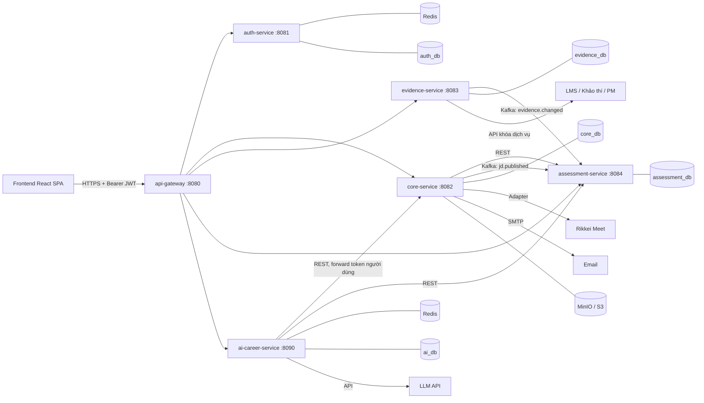

# Rikkei Jobs: Tài liệu Tech Stack và Kiến trúc (MVP)

| Thông tin | Nội dung |
|---|---|
| Phiên bản | 1.0 (bản đề xuất để nhóm chốt trước khi triển khai) |
| Trạng thái | Chờ nhóm xác nhận |
| Quy mô nhóm | 6 thành viên |
| Thời gian thực hiện | 10 tuần (khoảng 2,5 tháng), tuần 11 là dự phòng |
| Ngày lập | 09/11/2026 |

---

## 1. Mục đích tài liệu

Tài liệu này giúp mọi thành viên nắm được bức tranh chung về công nghệ và kiến trúc trước khi viết code. Nội dung gồm phạm vi MVP, các quyết định kiến trúc đã chốt, danh sách service, công nghệ dùng ở từng nơi, quy ước phát triển, lộ trình và phân công gợi ý. Mọi thay đổi về công nghệ sau khi tài liệu được chốt phải được ghi vào mục 3 (Quyết định kiến trúc) kèm lý do.

---

## 2. Phạm vi MVP

Đặc tả đầy đủ có 7 module và 8 tích hợp. Với 6 người và 10 tuần, nhóm không thể hoàn thiện toàn bộ mức sâu của đặc tả. MVP giữ đầy đủ luồng nghiệp vụ cốt lõi và các ràng buộc bảo mật bắt buộc, nhưng đơn giản hóa một số phần.

### 2.1 Trong phạm vi MVP

| Nhóm chức năng | Nội dung cần hoàn thành |
|---|---|
| Xác thực | SSO bằng vé dùng một lần (60 giây), đăng nhập HR, khóa tài khoản sau 5 lần sai (15 phút), đổi mật khẩu lần đầu, quên mật khẩu (link 30 phút, dùng một lần) |
| Hồ sơ năng lực | Skill profile, CV chuẩn (tạo và sửa), portfolio, upload chứng chỉ và avatar có kiểm tra an toàn |
| Công khai hồ sơ | Consent bật và tắt, phê duyệt của cán bộ, thu hồi có hiệu lực ngay, tìm kiếm ứng viên công khai |
| Doanh nghiệp và JD | Hồ sơ doanh nghiệp, tạo và sửa JD, kỹ năng bắt buộc và ưu tiên, duyệt JD, trạng thái JD |
| Tuyển dụng | Ứng tuyển, sàng lọc, lịch phỏng vấn nhiều vòng, offer, hết hạn offer, nhắc lịch (1 ngày và 1 giờ) |
| Thực tập IOC | Đặt nhu cầu thực tập, ghép ứng viên vào đợt IOC, đồng bộ kết quả nghiệm thu |
| Đánh giá năng lực | Phiếu tự đánh giá, phiếu Mentor (Nháp và Đã gửi), chỉ số kỹ năng có trọng số, badge theo điều kiện kép |
| Điểm khớp và thiếu hụt | Điểm khớp JD (0 đến 100), cảnh báo kỹ năng bắt buộc còn thiếu, khoảng thiếu hụt, gợi ý môn học trên LMS |
| Đồng bộ dữ liệu | Đồng bộ đêm và theo yêu cầu, bằng chứng nguồn, chỉnh sửa tay có lý do, không ghi đè dữ liệu chỉnh tay |
| AI Career Assistant | Gợi ý việc làm, review CV, mock interview bám theo JD, che PII trước khi gọi LLM, giới hạn lượt dùng mỗi ngày |
| Bảo mật và audit | Ma trận phân quyền kiểm tra ở backend, nhật ký bất biến, xóa dữ liệu theo yêu cầu, "Báo sai" bằng chứng |

### 2.2 Ngoài phạm vi hoặc dùng giả lập

| Hạng mục | Cách xử lý trong MVP | Ghi chú |
|---|---|---|
| API thật của LMS, Khảo thí, PM | Dùng WireMock giả lập theo hợp đồng API đã thống nhất | Chuyển sang API thật khi có quyền truy cập |
| Rikkei Meet | Adapter với implementation giả, sinh link phòng họp dạng mock | Thay bằng API thật khi có tài liệu |
| Gửi email thật | Dev dùng Mailpit, staging dùng SMTP của nhà cung cấp | Không gửi email thật trong môi trường dev |
| Elasticsearch / OpenSearch | Không dùng, tìm kiếm bằng PostgreSQL | Xem quyết định D09 |
| Kubernetes | Staging chạy bằng Docker Compose trên một máy chủ | Kubernetes để giai đoạn sau |
| Phân tích tải (load test) | Không thực hiện | Có thể bổ sung nếu còn thời gian |
| Tách audit-service, learning-service riêng | Gộp vào service nghiệp vụ liên quan | Xem quyết định D06 và mục 5 |

---

## 3. Quyết định kiến trúc đã chốt

| Mã | Quyết định | Lý do | Trạng thái |
|---|---|---|---|
| D01 | Microservice mức vừa: 1 API Gateway, 5 service nghiệp vụ, 1 service AI bằng Python, 1 frontend SPA | Đặc tả gốc có 11 service. Với 6 người và 10 tuần, mỗi service cần ít nhất 2 người hiểu code. Gộp các module có chung dữ liệu sẽ giảm số lần tích hợp và số deployable | Chốt |
| D02 | Java source 17, chạy trên JDK 25 (LTS), Spring Boot 4.1.1 | Phù hợp kiến thức khóa học. JDK 25 là bản LTS mới nhất | Chốt, cần kiểm tra tương thích Spring Cloud, Spring Kafka, Spring Batch trong tuần 1 |
| D03 | Mỗi service có database PostgreSQL riêng (hoặc schema riêng), không truy cập DB của service khác | Tránh phụ thuộc chéo, cho phép từng service thay đổi schema độc lập | Chốt |
| D04 | Giao tiếp đồng bộ bằng REST (kèm Resilience4j). Giao tiếp bất đồng bộ bằng Kafka, chỉ dùng cho 3 topic | Tránh mở rộng Kafka quá mức trong thời gian ngắn | Chốt |
| D05 | Transactional Outbox cho các sự kiện gửi qua Kafka | Đảm bảo dữ liệu đã ghi và sự kiện đã gửi không bị lệch nhau | Chốt |
| D06 | Audit log ghi trong cùng database của service, bảng append-only (quyền UPDATE và DELETE bị thu hồi, có trigger chặn). Không tách audit-service riêng trong MVP | Giữ được tính bất biến, giảm một service. Nếu cần, có thể tách sau | Chốt |
| D07 | JWT ký bằng RS256. auth-service phát token. Các service xác thực bằng public key lấy từ JWKS | Không chia sẻ secret ký giữa các service | Chốt |
| D08 | Vé SSO lưu trong Redis với TTL 60 giây, tiêu thụ bằng lệnh GETDEL | Nguyên tử, không dùng lại được, không cần truy vấn DB | Chốt. Cách LMS đăng ký vé cần thống nhất (xem mục 15) |
| D09 | Tìm kiếm ứng viên bằng PostgreSQL (tsvector, GIN index) | Không cần đồng bộ index. Thu hồi công khai có hiệu lực ngay trong cùng DB | Chốt. Xem lại nếu dữ liệu vượt vài trăm nghìn hồ sơ |
| D10 | Điều kiện công khai (consent và phê duyệt) được kiểm tra tại thời điểm truy vấn | Đảm bảo thu hồi có hiệu lực tức thì, kể cả khi có cache kết quả tìm kiếm | Chốt |
| D11 | Frontend là React SPA. Access token giữ trong bộ nhớ, refresh token lưu trong cookie HttpOnly, Secure, SameSite | Giảm rủi ro đánh cắp token qua XSS so với localStorage | Chốt |
| D12 | AI service viết bằng Python FastAPI. Che PII trước khi gọi LLM. Contract gửi sang AI không có trường email, SĐT, mã học viên | Hệ sinh thái AI và xử lý PDF của Python mạnh. Thiết kế contract giúp PII không bao giờ đi ra ngoài | Chốt |
| D13 | File lưu trên MinIO (dev) hoặc S3 (staging). Truy cập bằng presigned URL có thời hạn. Quét mã độc bằng ClamAV. Kiểm tra MIME thật bằng Apache Tika | Chặn tệp giả đuôi, SVG và HTML chứa script | Chốt |
| D14 | Monorepo. Backend dùng Maven multi-module. CI/CD bằng GitHub Actions | Một nơi quản lý code, một quy trình review, dễ chia sẻ module common | Chốt |
| D15 | Mọi tích hợp bên ngoài đi qua một lớp adapter (interface). Ở MVP, adapter có implementation giả lập | Để nhóm không bị chặn khi API bên ngoài chưa sẵn sàng | Chốt |

---

## 4. Kiến trúc tổng thể



Luồng xử lý chính: frontend gọi mọi API qua gateway. Gateway kiểm tra chữ ký JWT và giới hạn tần suất gọi. Các service tự kiểm tra quyền theo vai trò và quyền sở hữu dữ liệu. Frontend không được coi là lớp bảo vệ.

---

## 5. Danh sách service MVP

| Service | Port (local) | Database | Trách nhiệm | Module nội bộ (package) |
|---|---|---|---|---|
| `api-gateway` | 8080 | Không có (Redis cho rate limit) | Định tuyến, kiểm tra JWT, giới hạn tần suất, CORS | Không có |
| `auth-service` | 8081 | `auth_db` | Đổi vé SSO, đăng nhập HR, khóa tài khoản, đặt lại mật khẩu, cấp JWT, JWKS | `sso`, `hr-account`, `password`, `token` |
| `core-service` | 8082 | `core_db` | Hồ sơ ứng viên, CV, portfolio, consent, doanh nghiệp, JD, ứng tuyển, phỏng vấn, offer, IOC, thông báo, audit, xóa dữ liệu | `profile`, `company`, `job`, `recruitment`, `ioc`, `notification`, `consent` |
| `evidence-service` | 8083 | `evidence_db` | Đồng bộ bằng chứng từ LMS, Khảo thí, PM. Ghi nhận chỉnh sửa tay và báo sai | `sync`, `source`, `evidence`, `override` |
| `assessment-service` | 8084 | `assessment_db` | Danh mục kỹ năng, phiếu tự đánh giá và phiếu Mentor, tính chỉ số, badge, điểm khớp, khoảng thiếu hụt, gợi ý học bù | `catalog`, `form`, `scoring`, `badge`, `matching`, `gap`, `learning` |
| `ai-career-service` | 8090 | `ai_db` (log), Redis (rate limit) | Trợ lý nghề nghiệp: gợi ý việc, review CV, mock interview | `chat`, `masking`, `quota`, `prompts` |

Ghi chú về `core-service`: đây là service lớn nhất. Các module được tách package rõ ràng để hai người có thể làm song song mà ít xung đột. Nếu sau MVP cần tách, ranh giới module đã sẵn sàng.

---

## 6. Tech stack chi tiết

### 6.1 Backend: công nghệ dùng chung

| Nhóm | Công nghệ | Phiên bản | Dùng ở đâu | Mục đích |
|---|---|---|---|---|
| Ngôn ngữ | Java | Source 17, runtime JDK 25 LTS | Tất cả service Java | Ngôn ngữ chính. Dùng record cho DTO |
| Framework | Spring Boot | 4.1.1 (kiểm tra tương thích tuần 1) | Tất cả service Java | Nền tảng ứng dụng, auto-configuration, Actuator |
| Web | Spring Web MVC | Theo Spring Boot | Tất cả service Java | Xây dựng REST API |
| Validation | Jakarta Bean Validation (Hibernate Validator) | Theo Spring Boot | Request DTO | Kiểm tra dữ liệu đầu vào |
| Lỗi chuẩn hóa | ProblemDetail (RFC 9457) | Theo Spring Boot | Module `common` | Trả lỗi thống nhất cho mọi service |
| Bảo mật | Spring Security (OAuth2 Resource Server, JWT) | Theo Spring Boot | Tất cả service Java | Xác thực JWT, phân quyền theo vai trò |
| Băm mật khẩu | Spring Security Argon2PasswordEncoder | Theo Spring Security | `auth-service` | Băm mật khẩu HR bằng Argon2id |
| Truy cập dữ liệu | Spring Data JPA (Hibernate) | Theo Spring Boot | Tất cả service Java | Ánh xạ entity và repository |
| Truy vấn tìm kiếm | Native query PostgreSQL (tsvector, GIN) | PostgreSQL 17 | `core-service` (tìm kiếm ứng viên) | Tìm kiếm toàn văn |
| Migration | Flyway | Theo Spring Boot | Tất cả service Java | Quản lý schema có phiên bản |
| Mapping DTO | MapStruct | Bản mới ổn định | Tất cả service Java | Chuyển đổi entity và DTO, tránh viết tay |
| Redis | Spring Data Redis (Lettuce) | Theo Spring Boot | `auth`, `gateway`, `assessment` (cache), `ai` | Lưu vé SSO, bộ đếm đăng nhập, cache |
| Kafka | Spring for Apache Kafka | Theo Spring Boot | `evidence`, `core`, `assessment` | Producer và consumer cho 3 topic |
| Outbox | Bảng `outbox_event` và scheduler tự viết | Tự phát triển | Service phát sự kiện | Đảm bảo gửi sự kiện đáng tin cậy (D05) |
| Batch | Spring Batch | Theo Spring Boot | `evidence-service` | Đồng bộ đêm theo chunk, có restart và skip |
| Lập lịch bền | Quartz Scheduler (JDBC job store) | Theo Spring Boot | `core-service` | Nhắc lịch phỏng vấn, tự đóng offer quá hạn. Lịch không mất khi restart |
| Chịu lỗi | Resilience4j (circuit breaker, retry, timeout) | Bản tương thích Boot 4 | `evidence`, `core` (Meet, email), `ai` | Không để một nguồn chậm kéo sập hệ thống |
| HTTP client | RestClient | Theo Spring Framework | Các service gọi REST nội bộ và bên ngoài | Gọi API, kết hợp Resilience4j |
| Email | Spring Boot Starter Mail, Thymeleaf | Theo Spring Boot | `core-service` (notification) | Gửi email theo template |
| Tài liệu API | springdoc-openapi | Bản tương thích Boot 4 | Tất cả service Java | Sinh OpenAPI, là hợp đồng với frontend |
| Lưu trữ tệp | AWS SDK for Java v2 (S3 client) | Bản mới ổn định | `core-service` | Làm việc với MinIO và S3, tạo presigned URL |
| Quét mã độc | Client ClamAV (giao tiếp clamd qua TCP) | Bản mới ổn định | `core-service` | Quét tệp sau khi upload |
| Phát hiện MIME | Apache Tika | Bản mới ổn định | `core-service` | Xác định định dạng thật của tệp, chặn SVG và HTML |
| Logging | SLF4J, Logback, log dạng JSON | Theo Spring Boot | Tất cả service | Log có cấu trúc. Không log email, SĐT, mã học viên |
| Metric | Micrometer, Spring Boot Actuator | Theo Spring Boot | Tất cả service | Endpoint health và metric cho Prometheus |
| Kiểm thử | JUnit 5, Mockito, AssertJ | Theo Spring Boot | Tất cả service Java | Unit test và kiểm thử logic |
| Kiểm thử tích hợp | Testcontainers (PostgreSQL, Redis, Kafka) | Bản mới ổn định | Tất cả service Java | Chạy DB và broker thật trong container |
| Giả lập API ngoài | WireMock | Bản mới ổn định | `evidence-service`, `core-service` | Giả lập LMS, Khảo thí, PM, Meet |

Không dùng Lombok để giảm phụ thuộc vào plugin IDE. Dùng record cho DTO và MapStruct cho mapping.

### 6.2 Backend: công nghệ đặc thù theo service

| Service | Công nghệ đặc thù | Mục đích cụ thể |
|---|---|---|
| `api-gateway` | Spring Cloud Gateway (bản tương thích Boot 4), Redis RateLimiter | Định tuyến `/api/v1/**` tới từng service. Giới hạn số request theo IP và theo tài khoản. Chặn request không có JWT hợp lệ |
| `auth-service` | Spring Security, Redis, Argon2id, cặp khóa RSA, endpoint JWKS | Xử lý vé SSO (GETDEL). Đăng nhập HR. Đếm lần sai (5 lần sai thì khóa 15 phút). Token reset password dạng hash, hết hạn 30 phút, dùng một lần |
| `core-service` | JPA, tsvector, Quartz, Spring Mail, Thymeleaf, AWS SDK S3, ClamAV, Tika, Resilience4j | Hồ sơ, CV, portfolio, consent, JD, state machine đơn ứng tuyển (có optimistic lock qua cột `version`), lịch phỏng vấn, offer, IOC, thông báo, audit, xóa dữ liệu |
| `evidence-service` | Spring Batch, RestClient, Resilience4j, WireMock (dev), Kafka producer | Job đồng bộ đêm theo từng nguồn. Đồng bộ theo yêu cầu khi ứng viên mở hồ sơ. Upsert theo khóa nguồn (idempotent). Bỏ qua bản ghi đã có override |
| `assessment-service` | JPA, Spring Cache (Redis), Kafka consumer, JUnit tham số hóa | Tính chỉ số kỹ năng theo công thức có trọng số. Test từng công thức bằng bộ dữ liệu mẫu. Cache kết quả điểm khớp, xóa cache khi có `evidence.changed` hoặc `jd.published` |
| `ai-career-service` | Xem mục 6.4 | Xem mục 6.4 |

### 6.3 Frontend

| Nhóm | Công nghệ | Phiên bản | Dùng ở đâu | Mục đích |
|---|---|---|---|---|
| Thư viện UI | React | 19 | Toàn bộ SPA | Xây dựng giao diện theo component |
| Ngôn ngữ | TypeScript | 5.x | Toàn bộ SPA | Kiểu dữ liệu, sinh type từ OpenAPI |
| Build tool | Vite | Bản ổn định mới nhất | Dev server, build | Khởi động nhanh, hot reload |
| Styling | Tailwind CSS | v4 | Toàn bộ giao diện | Styling theo utility class, nhất quán thiết kế |
| Component | shadcn/ui (Radix UI + Tailwind) | Bản mới nhất | Button, dialog, form, table, dropdown | Có sẵn component chất lượng, sao chép vào dự án, không phải thêm dependency nặng |
| Định tuyến | React Router | v7 | Toàn bộ SPA | Route theo vai trò, route guard |
| HTTP client | Axios | 1.x | `src/api/client.ts` | Gắn Bearer token, interceptor refresh khi nhận 401, chuẩn hóa lỗi, `withCredentials: true` |
| Dữ liệu server | TanStack Query | v5 | Mọi trang có gọi API | Cache, loading và error state, invalidate sau khi đổi trạng thái |
| Form | React Hook Form + Zod | Bản ổn định mới nhất | Form CV, JD, phiếu đánh giá, lịch phỏng vấn | Validate bằng schema, dùng chung với type |
| Biểu đồ | Recharts | Bản ổn định mới nhất | Trang skill profile, so sánh tự khai | Biểu đồ cột, radar. Điểm tự khai hiển thị riêng, không cộng vào chỉ số chính thức |
| Xem tệp | react-pdf hoặc iframe với presigned URL | Bản ổn định mới nhất | Xem CV, chứng chỉ | Không tải tệp công khai |
| Lịch | react-big-calendar, date-fns | Bản ổn định mới nhất | Chọn khung giờ phỏng vấn | Hiển thị khung giờ trống và chọn giờ |
| Sinh type từ API | openapi-typescript | Bản ổn định mới nhất | Thư mục `src/api/types` | Sinh type từ OpenAPI của backend, tránh lệch contract |
| Kiểm thử | Vitest, Testing Library | Bản ổn định mới nhất | Component và hook | Unit test và test component |
| E2E | Playwright | Bản ổn định mới nhất | Thư mục `e2e/` | Kiểm thử 5 luồng chính theo vai trò |
| Lint và format | ESLint, Prettier | Bản ổn định mới nhất | Toàn bộ frontend | Đồng nhất code style |

Quy ước frontend:
- Lưu access token trong bộ nhớ (React state hoặc biến module). Refresh token nằm trong cookie HttpOnly, frontend không đọc được.
- Không dùng `localStorage` hoặc `sessionStorage` để lưu token.
- Không dùng `dangerouslySetInnerHTML` với nội dung do người dùng nhập (nhận xét Mentor, mô tả JD, portfolio).
- Route guard chỉ để điều hướng giao diện. Mọi kiểm tra quyền thật nằm ở backend.

### 6.4 AI Career Assistant (Python)

| Nhóm | Công nghệ | Phiên bản | Dùng ở đâu | Mục đích |
|---|---|---|---|---|
| Ngôn ngữ | Python | 3.12 | `ai-career-service` | Hệ sinh thái AI và xử lý tài liệu |
| Quản lý package | uv | Bản ổn định mới nhất | `ai-career-service` | Cài đặt nhanh, khóa phiên bản bằng lockfile |
| Web framework | FastAPI | Bản ổn định mới nhất | `ai-career-service` | API bất đồng bộ, sinh OpenAPI tự động |
| Server | Uvicorn | Bản ổn định mới nhất | Chạy FastAPI | ASGI server |
| Schema | Pydantic v2 | 2.x | Request và response | Kiểm tra dữ liệu, định nghĩa contract |
| HTTP client | httpx (async) | Bản ổn định mới nhất | Gọi `core-service` và `assessment-service` | Lấy dữ liệu của chính người dùng đang đăng nhập |
| LLM SDK | SDK của nhà cung cấp đã chọn (Anthropic hoặc OpenAI) | Bản ổn định mới nhất | Gọi LLM | Tạo phản hồi, review CV, mock interview. Tên model đặt trong cấu hình |
| Trích xuất PDF | pypdf (hoặc pdfplumber nếu cần bảng) | Bản ổn định mới nhất | Đọc nội dung CV | Lấy văn bản từ CV để đưa vào prompt |
| Masking PII | Module `masking` tự viết dựa trên regex (email, SĐT, mã học viên), có thể dùng Presidio nếu cần | Tự phát triển | Trước mọi lời gọi LLM | Che thông tin định danh trước khi gửi ra ngoài |
| Rate limit | Redis (đếm theo ngày, theo tài khoản) | Dùng chung instance Redis | Module `quota` | Giới hạn số lượt AI mỗi ngày cho mỗi tài khoản |
| ORM và migration | SQLAlchemy 2.x, Alembic | Bản ổn định mới nhất | Bảng `ai_interaction_log` | Lưu nhật ký tương tác |
| Xóa log sau 90 ngày | Job chạy hàng ngày (APScheduler hoặc cron trong container) | Bản ổn định mới nhất | `ai-career-service` | Xóa bản ghi cũ hơn 90 ngày |
| Lint và kiểm thử | Ruff, pytest, pytest-asyncio | Bản ổn định mới nhất | Toàn bộ service | Kiểm tra code style và unit test |

Quy tắc bắt buộc của AI service:
- Thứ tự xử lý: nhận request (đã có token), lấy dữ liệu của đúng người dùng đó, che PII, ghép prompt, gọi LLM, lưu log đã che PII. Không bước nào được bỏ qua.
- Không bao giờ truy vấn dữ liệu của người dùng khác. Mọi lời gọi tới `core-service` và `assessment-service` đều dùng token của người đang đăng nhập.
- Log tương tác không lưu bản gốc có PII.

### 6.5 Hạ tầng, DevOps và công cụ

| Nhóm | Công nghệ | Dùng ở đâu | Mục đích |
|---|---|---|---|
| Quản lý mã nguồn | Git, GitHub (monorepo) | Toàn bộ dự án | Lưu code, review qua Pull Request, bật branch protection cho `main` |
| CI | GitHub Actions | Thư mục `.github/workflows/` | Build và test từng module khi có thay đổi (path filter), build Docker image |
| Container | Docker, Docker Compose | Môi trường local và staging | Chạy toàn bộ hạ tầng và service bằng một lệnh |
| Database | PostgreSQL 17 | Local, staging | Một instance chứa nhiều database theo service |
| Cache và TTL | Redis 7 | Local, staging | Vé SSO, bộ đếm, rate limit, cache |
| Message broker | Apache Kafka (KRaft, không dùng Zookeeper) | Local, staging | 3 topic: `evidence.changed`, `jd.published`, `jd.updated` |
| Object storage | MinIO (dev), S3 (staging) | Lưu CV, chứng chỉ, avatar | Lưu tệp với presigned URL |
| Quét mã độc | ClamAV | Local, staging | Quét tệp upload |
| Email dev | Mailpit | Local | Bắt email gửi đi để kiểm tra, không gửi ra ngoài |
| Giả lập API | WireMock | Local, CI | Giả lập LMS, Khảo thí, PM, Meet |
| Quan sát hệ thống | Prometheus, Grafana, log JSON | Staging | Dashboard metric, theo dõi lỗi |
| Trace | OpenTelemetry | Giai đoạn 2 | Theo dõi request xuyên service (không bắt buộc trong MVP) |
| Quản lý secret | File `.env` cục bộ (không commit), GitHub Secrets cho CI | Toàn bộ | Không đưa secret vào code hoặc repo |
| Quản lý công việc | GitHub Projects | Toàn bộ nhóm | Theo dõi task và sprint trên cùng nơi với code |
| Kiểm thử API thủ công | Bruno (collection lưu trong repo) | `docs/api/` | Chia sẻ bộ request giữa các thành viên |
| Hosting staging | Một máy chủ (VM) chạy Docker Compose | Staging | Đơn giản, đủ cho demo và kiểm thử |

### 6.6 Kiểm thử

| Loại | Công nghệ | Phạm vi | Yêu cầu tối thiểu |
|---|---|---|---|
| Unit test backend | JUnit 5, Mockito, AssertJ | Logic nghiệp vụ, state machine, công thức điểm | Mọi công thức tính điểm có bộ test mẫu |
| Integration test backend | Testcontainers, WireMock | Repository, Kafka, Redis, luồng qua REST | Mỗi service có ít nhất một test tích hợp cho luồng chính |
| Kiểm thử phân quyền | Test tự động theo ma trận vai trò (role × endpoint) | Mọi endpoint có yêu cầu quyền | Đặc tả yêu cầu mỗi vai trò có kịch bản riêng. Mỗi endpoint mới phải có test phân quyền |
| Contract | OpenAPI (springdoc, FastAPI tự sinh) | Hợp đồng giữa frontend và backend | Thay đổi API phải cập nhật OpenAPI |
| Unit test frontend | Vitest, Testing Library | Component, hook, logic form | Các component có logic điều kiện theo vai trò |
| E2E | Playwright | 5 luồng: SSO, HR đăng JD, ứng viên ứng tuyển, thu hồi công khai, mentor gửi phiếu | Chạy trong CI trước khi merge vào `main` |
| Unit test AI | pytest | Module masking, quota, prompt | Test masking bằng bộ dữ liệu có PII giả |

---

## 7. Cơ sở dữ liệu theo service

| Service | Database | Các bảng và đối tượng chính |
|---|---|---|
| `auth-service` | `auth_db` | `hr_account`, `password_reset_token` (lưu hash, có `expires_at`, `used_at`), `audit_log` |
| `core-service` | `core_db` | `candidate_profile`, `cv`, `portfolio_item`, `certificate`, `visibility_consent`, `company`, `job_posting`, `job_skill_requirement`, `application`, `application_status_history` (append-only), `interview`, `interview_round`, `offer`, `internship_demand`, `ioc_batch`, `ioc_placement`, `contact_unlock`, `notification`, `outbox_event`, `audit_log`, các bảng của Quartz |
| `evidence-service` | `evidence_db` | `source_record` (dữ liệu từ nguồn, có khóa nguồn), `evidence_override` (chỉnh tay, có lý do), `evidence_report` (báo sai), `sync_run`, `sync_checkpoint`, `outbox_event`, `audit_log` |
| `assessment-service` | `assessment_db` | `skill`, `skill_weight_config`, `badge_definition`, `self_assessment`, `mentor_form`, `mentor_form_item`, `skill_score` (snapshot), `badge_award`, `match_result`, `skill_gap`, `outbox_event`, `audit_log` |
| `ai-career-service` | `ai_db` | `ai_interaction_log` (có `created_at` để xóa sau 90 ngày) |

Quy tắc chung: bảng lịch sử (`application_status_history`, `audit_log`, `evidence_override`) chỉ cho phép INSERT. Tài khoản ứng dụng không có quyền UPDATE hoặc DELETE trên các bảng này.

---

## 8. Các luồng tích hợp chính

### 8.1 Đăng nhập SSO

| Bước | Hành động | Nơi xử lý |
|---|---|---|
| 1 | Người dùng bấm vào cổng từ hệ thống LMS. LMS tạo vé dùng một lần | LMS |
| 2 | Vé được đăng ký với auth-service và lưu trong Redis với TTL 60 giây (cách đăng ký cần thống nhất, xem mục 15) | LMS, auth-service, Redis |
| 3 | Frontend nhận vé ở route `/sso`, gọi `POST /api/v1/auth/sso/exchange` | Frontend |
| 4 | auth-service thực hiện GETDEL trên vé. Nếu không tồn tại hoặc đã hết hạn thì từ chối | auth-service, Redis |
| 5 | auth-service tạo access token (JWT RS256, hạn ngắn) và refresh token (cookie HttpOnly). Thời hạn cụ thể cần xác nhận | auth-service |
| 6 | Các request sau mang Bearer token. Gateway kiểm tra chữ ký, service kiểm tra quyền | api-gateway, các service |

### 8.2 Đồng bộ bằng chứng

| Bước | Hành động | Nơi xử lý |
|---|---|---|
| 1 | Job đêm (Spring Batch) chạy theo từng nguồn, hoặc đồng bộ theo yêu cầu khi ứng viên mở hồ sơ | evidence-service |
| 2 | Gọi API nguồn qua Resilience4j (timeout, retry, circuit breaker). Khi nguồn lỗi, ghi `sync_run` và giữ dữ liệu cũ | evidence-service |
| 3 | Upsert vào `source_record` theo khóa nguồn (idempotent). Không ghi vào bản ghi đã có bản ghi trong `evidence_override` | evidence-service |
| 4 | Ghi sự kiện `evidence.changed` vào `outbox_event` trong cùng transaction. Scheduler gửi lên Kafka | evidence-service |
| 5 | assessment-service nhận sự kiện, tính lại `skill_score` và xóa cache điểm khớp liên quan | assessment-service |

### 8.3 Điểm khớp và khoảng thiếu hụt

| Bước | Hành động | Nơi xử lý |
|---|---|---|
| 1 | Khi HR mở danh sách ứng viên hoặc ứng viên mở gợi ý JD, assessment-service kiểm tra `match_result` đã có và còn hợp lệ | assessment-service |
| 2 | Nếu chưa có hoặc đã bị xóa cache, tính điểm theo công thức trọng số và lưu kết quả | assessment-service |
| 3 | Kỹ năng bắt buộc bị thiếu không làm ứng viên bị ẩn. Hệ thống hiển thị kèm cảnh báo rõ ràng | assessment-service, frontend |
| 4 | Khoảng thiếu hụt (chỉ số hiện tại nhỏ hơn mức JD yêu cầu) được ánh xạ sang môn học và bài học trên LMS | assessment-service, learning module |

### 8.4 Thu hồi công khai hồ sơ

| Bước | Hành động | Nơi xử lý |
|---|---|---|
| 1 | Ứng viên bấm rút công khai. Trong một transaction, cờ consent chuyển về Riêng tư và ghi lịch sử | core-service |
| 2 | Mọi truy vấn tìm kiếm ứng viên đều lọc theo cờ consent tại thời điểm truy vấn, nên hồ sơ biến mất ngay | core-service |
| 3 | Doanh nghiệp vẫn xem được hồ sơ gắn với đơn ứng tuyển nộp trước thời điểm rút (ngoại lệ trong đặc tả). Điều kiện này được kiểm tra ở endpoint xem hồ sơ | core-service |
| 4 | Email và SĐT chỉ mở khóa khi ứng viên nộp đơn vào JD của doanh nghiệp đó, hoặc cán bộ duyệt mở. Mọi lần mở đều ghi audit | core-service |

---

## 9. Quy ước phát triển

| Hạng mục | Quy ước |
|---|---|
| Định dạng API | Prefix `/api/v1/`, danh từ số nhiều (`/jobs`, `/applications`), JSON camelCase |
| Lỗi | ProblemDetail (RFC 9457). Không trả stack trace ra ngoài |
| Phân trang | `?page=0&size=20&sort=createdAt,desc` |
| Thời gian | Lưu UTC bằng `timestamptz`. Trả về ISO-8601 |
| Khóa định danh | UUID |
| Phân quyền | Kiểm tra vai trò ở controller (`@PreAuthorize`). Kiểm tra quyền sở hữu (object-level) ở tầng service. Không chỉ ẩn nút trên giao diện |
| Cấu trúc package | `vn.rikkei.jobs.<service>.<module>.{api, application, domain, infrastructure}` |
| DTO và entity | DTO dùng record. Entity không được trả trực tiếp ra API |
| Migration | `V<số>__<mô_tả>.sql`. Không sửa migration đã merge, chỉ thêm migration mới |
| Nhánh Git | `main` được bảo vệ. Nhánh tính năng: `feature/<service>-<mô-tả>` |
| Commit | Conventional Commits: `feat:`, `fix:`, `refactor:`, `test:`, `docs:`, `chore:` |
| Pull Request | Ít nhất 1 người review và approve. CI phải xanh. PR nhỏ (dưới khoảng 400 dòng thay đổi nếu có thể) |
| Định dạng code | Backend: Spotless với google-java-format. Frontend: ESLint, Prettier. AI: Ruff |
| Log | Không log email, SĐT, mã học viên, token, mật khẩu |
| Secret | Không commit secret. Có file `.env.example` mô tả biến môi trường |
| Quyền sở hữu package | `common` do Tech Lead duy trì. Module `profile` (M2) và `job`, `recruitment` (M3) trong `core-service` do người được phân công phụ trách |

Định nghĩa "hoàn thành" (Definition of Done) cho một task:
- Code đã được review và merge vào `main`.
- Có unit test cho logic nghiệp vụ. Có integration test nếu task có đụng tới database hoặc Kafka.
- Nếu có endpoint mới: đã cập nhật OpenAPI và có test phân quyền cho từng vai trò liên quan.
- Không có secret trong code. Log không chứa PII.
- Đã chạy được trên môi trường local bằng Docker Compose.

---

## 10. Môi trường local

| Thành phần | Image hoặc công cụ | Port | Ghi chú |
|---|---|---|---|
| PostgreSQL | `postgres:17` | 5432 | Script khởi tạo tạo các database `auth_db`, `core_db`, `evidence_db`, `assessment_db`, `ai_db` |
| Redis | `redis:7` | 6379 | Tách key theo prefix của từng service |
| Kafka | `apache/kafka` (KRaft) | 9092 | Tạo sẵn 3 topic |
| MinIO | `minio/minio` | 9000 (API), 9001 (console) | Tạo bucket `rikkei-files` |
| ClamAV | `clamav/clamav` | 3310 | Khởi động mất vài phút để tải dữ liệu virus |
| Mailpit | `axllent/mailpit` | 1025 (SMTP), 8025 (giao diện web) | Xem email gửi đi |
| WireMock | `wiremock/wiremock` | 8089 | Mapping giả lập LMS, Khảo thí, PM đặt trong `infra/wiremock/` |
| Các service | Chạy bằng `mvn spring-boot:run` hoặc container | Theo mục 5 | Có thể chạy một phần khi chỉ làm một service |
| Frontend | `npm run dev` | 5173 | Proxy `/api` về gateway |
| AI service | `uv run uvicorn` | 8090 | Cần biến môi trường cho khóa LLM |

---

## 11. Cấu trúc repository

```
rikkei-jobs/
├── backend/
│   ├── pom.xml                      # Parent POM, quản lý phiên bản chung
│   ├── common/                      # Lỗi chuẩn, security filter, audit, test utilities
│   ├── api-gateway/
│   ├── auth-service/
│   ├── core-service/                # Module: profile, company, job, recruitment, ioc, notification, consent
│   ├── evidence-service/
│   └── assessment-service/
├── ai-career-service/               # FastAPI, pyproject.toml, uv.lock
├── frontend/                        # React, Vite, Tailwind, src/api/, src/features/, e2e/
├── infra/
│   ├── docker-compose.yml
│   ├── init-db/                     # Script tạo database
│   ├── wiremock/mappings/           # Giả lập LMS, Khảo thí, PM, Meet
│   └── k8s/                         # Để dành giai đoạn sau
├── docs/
│   ├── api/                         # Bộ request Bruno và OpenAPI xuất ra
│   ├── adr/                         # Ghi quyết định kiến trúc (một file một quyết định)
│   └── tech-stack.md                # Tài liệu này
├── .github/workflows/               # CI: build, test, E2E
├── .env.example
└── README.md
```

---

## 12. Phân công gợi ý

Phân công dưới đây là gợi ý để quản lý điều chỉnh. Cột "Thành viên" để trống để điền sau khi chốt.

| Vị trí | Phụ trách chính | Phụ trách phụ | Thành viên |
|---|---|---|---|
| M1: Tech Lead và DevOps | Kiến trúc, repo, CI/CD, Docker Compose, `api-gateway`, `common`, review PR | Hỗ trợ tích hợp frontend và backend | |
| M2: Backend A | `auth-service`, module `profile` và `consent` trong `core-service` | Tìm kiếm ứng viên | |
| M3: Backend B | Module `company`, `job`, `recruitment`, `ioc`, `notification` trong `core-service` | Quartz (nhắc lịch, hết hạn offer) | |
| M4: Backend C | `evidence-service` (đồng bộ, override, WireMock) | `ai-career-service` từ tuần 7 | |
| M5: Backend D | `assessment-service` (danh mục kỹ năng, phiếu, điểm, badge, điểm khớp, thiếu hụt) | Module `learning` (gợi ý môn học trên LMS) | |
| M6: Frontend | Toàn bộ React SPA, shadcn/ui, route theo vai trò | E2E Playwright từ tuần 8 | |

Lưu ý về phân công: M3 và M2 cùng làm trong `core-service`, cần thống nhất ranh giới package từ tuần 1. M4 chuyển sang `ai-career-service` từ tuần 7. M6 là người duy nhất làm frontend, nên M1 nên hỗ trợ dựng layout chung và các component dùng chung trong tuần 2.

---

## 13. Lộ trình 10 tuần

Lộ trình chia thành 5 sprint, mỗi sprint 2 tuần. Tuần 11 là dự phòng.

| Sprint | Tuần | Mục tiêu | Đầu ra kiểm chứng được |
|---|---|---|---|
| S0 | 1 | Tạo repo và Docker Compose. Thiết lập CI. Spike Spring Boot 4.1.1 với Kafka, Batch, Quartz, Spring Cloud Gateway. Thống nhất hợp đồng API đầu tiên với đội LMS | Chạy được toàn bộ hạ tầng local. CI xanh. 6 service có skeleton và health endpoint |
| S1 | 2–3 | `auth-service` (SSO, đăng nhập HR, khóa tài khoản, reset mật khẩu). `core-service`: profile CRUD, company, JD CRUD. Frontend: layout, đăng nhập, khung route theo vai trò | Đăng nhập SSO với WireMock. HR tạo được JD. Có test phân quyền cho các endpoint đã làm |
| S2 | 4–5 | `evidence-service` (đồng bộ đêm, upsert, override). `assessment-service` (danh mục kỹ năng, phiếu tự đánh giá, phiếu Mentor, chỉ số kỹ năng). `core-service`: ứng tuyển và state machine, upload CV và chứng chỉ có quét mã độc | Chỉ số kỹ năng tính đúng theo bộ test mẫu. Đơn ứng tuyển đi qua đủ trạng thái chính |
| S3 | 6–7 | Badge, điểm khớp, khoảng thiếu hụt. Phỏng vấn với Meet giả lập, offer, hết hạn offer, IOC. Consent, tìm kiếm ứng viên, thu hồi tức thì. Audit | Luồng tuyển dụng end-to-end chạy được. Thu hồi công khai có hiệu lực ngay (có test) |
| S4 | 8–9 | `ai-career-service` (gợi ý việc, review CV, mock interview) và module masking. Module `learning`. Củng cố: test phân quyền đầy đủ, kiểm thử bảo mật upload, E2E Playwright cho 5 luồng | Test ma trận phân quyền pass. 5 luồng E2E pass. Không còn lỗi PII trong log |
| S5 | 10 | Sửa lỗi, hoàn thiện tài liệu, chuẩn bị demo và môi trường staging | Demo được luồng chính trên staging |
| Dự phòng | 11 | Xử lý phần chậm tiến độ | Không phát sinh tính năng mới |

Ưu tiên khi bị trễ tiến độ, theo thứ tự cắt giảm: học bù (module `learning`) rút xuống mức thủ công. Tìm kiếm nâng cao rút xuống lọc cơ bản. Mock interview của AI rút xuống một loại câu hỏi. Các mục bảo mật, phân quyền và thu hồi công khai không được cắt.

---

## 14. Rủi ro

| Rủi ro | Mức | Giảm thiểu |
|---|---|---|
| Spring Boot 4.1.1 chưa tương thích đầy đủ với Spring Cloud Gateway, Spring Kafka hoặc Spring Batch | Cao | Spike trong tuần 1. Nếu có lỗi, hạ xuống bản 4.x ổn định đã kiểm chứng và ghi vào `docs/adr/` |
| API của LMS, Khảo thí, PM, Meet chưa sẵn sàng | Cao | WireMock và adapter ngay từ đầu. Thống nhất hợp đồng API trong tuần 1 |
| Một người làm toàn bộ frontend cho 6 vai trò | Cao | shadcn/ui để tăng tốc. M1 hỗ trợ layout và component chung. Ưu tiên luồng ứng viên và HR trước |
| Phạm vi phình to | Trung bình | Khóa phạm vi ở mục 2. Mọi thay đổi phạm vi đi qua quản lý dự án và cập nhật tài liệu |
| Kafka và Outbox tốn thời gian học | Trung bình | Chỉ dùng 3 topic. Nếu đến sprint 2 chưa ổn định, đơn giản hóa outbox bằng polling và giảm số topic |
| Lỗi bảo mật: IDOR, lộ PII, phát lại vé SSO | Cao | Test phân quyền tự động. Test riêng cho vé SSO đã dùng. Review bảo mật trước sprint 5 |
| Công thức điểm và trọng số chưa được xác nhận | Trung bình | Lưu trọng số trong bảng `skill_weight_config`, có giá trị mặc định. Điều chỉnh không cần đổi code |
| Phụ thuộc chéo giữa các thành viên trong `core-service` | Trung bình | Phân ranh giới package từ đầu. PR nhỏ, merge thường xuyên. Sync ngắn hằng ngày |

---

## 15. Câu hỏi cần chốt trước khi code

| STT | Câu hỏi | Ai quyết định | Hạn |
|---|---|---|---|
| 1 | Vé SSO do LMS tạo ra như thế nào, và đăng ký với auth-service bằng cách nào (API, chung Redis, hay JWT có chữ ký)? | Đội LMS và Tech Lead | Tuần 1 |
| 2 | Hợp đồng API của LMS, Khảo thí, PM đã có tài liệu chưa? Ai là đầu mối? | Quản lý dự án | Tuần 1 |
| 3 | Thang điểm từ các nguồn và cách quy đổi về 0 đến 100. Ngưỡng cho các bậc Cơ bản, Khá, Vững, Nâng cao | Quản lý dự án và đội Đào tạo | Tuần 1 |
| 4 | Trọng số mặc định cho từng nguồn bằng chứng | Quản lý dự án | Tuần 2 |
| 5 | Thời hạn access token và refresh token | Tech Lead | Tuần 1 |
| 6 | Rikkei Meet có API không? Nếu không, dùng link mock trong MVP có được chấp nhận không? | Quản lý dự án | Tuần 2 |
| 7 | Nhà cung cấp LLM (Anthropic hay OpenAI) và ngân sách token | Quản lý dự án | Tuần 2 |
| 8 | Có cần tìm kiếm tiếng Việt có dấu và không dấu không? | Quản lý dự án | Tuần 2 |
| 9 | Quy mô dự kiến (số hồ sơ, số lượt tìm kiếm mỗi ngày) | Quản lý dự án | Tuần 1 |
| 10 | Máy chủ staging do ai cung cấp, có quyền truy cập không? | Quản lý dự án | Tuần 2 |

Sau khi các câu hỏi trên được trả lời, cập nhật mục 3 và ghi lại trong `docs/adr/`.
